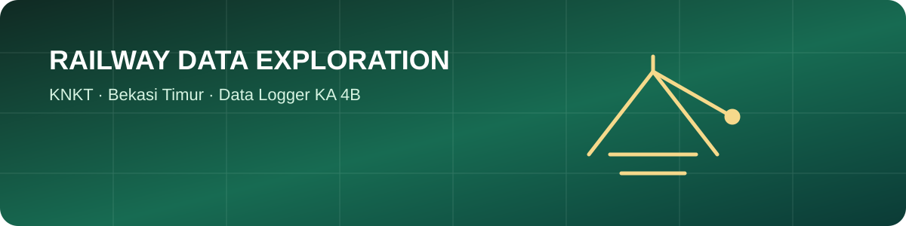

# EDA Data Logger KNKT — Bekasi Timur

**Analisis eksploratif rekaman Data Logger lokomotif KA 4B berdasarkan Laporan Akhir KNKT KNKT.26.04.03.02**

> [!IMPORTANT]
> Repository ini menganalisis transkripsi Tabel 6–10 dari laporan KNKT, bukan file biner atau ekspor mentah perangkat Data Logger. Hasil EDA tidak menetapkan penyebab kecelakaan, kesalahan personel, kegagalan persinyalan, ataupun hubungan kausal.

## Cerita analisis dalam 5 menit

Proyek ini menelaah rekaman parameter operasi lokomotif KA 4B dalam rentang waktu yang dicantumkan pada laporan KNKT. Tujuannya memeriksa kualitas data, memahami perubahan parameter, dan menyiapkan dasar analisis lanjutan yang dapat direproduksi.

| Tahap | Pertanyaan | Keluaran |
|---|---|---|
| 1. Memahami masalah | Apa yang dapat dijawab rekaman lokomotif? | Ruang lingkup dan batas analisis |
| 2. Memahami data | Dari tabel dan variabel apa data berasal? | Metadata, kamus data, provenance |
| 3. Memeriksa kualitas | Apakah nilai, waktu, dan struktur konsisten? | Laporan validasi dan missingness |
| 4. Mengeksplorasi | Bagaimana parameter berubah terhadap waktu? | Statistik, grafik, heatmap |
| 5. Mengomunikasikan | Apa temuan dan bukti tambahan yang diperlukan? | Laporan EDA dan rekomendasi |

## Dataset yang dianalisis

- **58 rekaman unik × 16 kolom** pada dataset gabungan.
- **59 baris sumber** sebelum penggabungan; satu timestamp 20:51:43 muncul pada dua tabel sumber.
- Rentang timestamp: **27 April 2026, 20:51:18–20:52:21**.
- Terdapat celah tujuh detik antara 20:51:27 dan 20:51:34; timestamp 20:51:28–20:51:33 tidak tersedia pada tabel transkripsi.
- Kolom akselerasi memuat tujuh placeholder `---`, bukan nilai numerik nol.

## Visualisasi

Jalankan generator visual setelah memasang dependensi:

~~~~bash
pip install -e ".[dev]"
python scripts/generate_visuals.py
~~~~

Hasil disimpan pada outputs/: GIF deret waktu kecepatan, PNG beresolusi tinggi, heatmap korelasi Spearman, dan HTML Plotly interaktif. Animasi memperlihatkan urutan rekaman yang tersedia; bukan simulasi fisika atau rekonstruksi sebab kecelakaan.

## Portal interaktif

Jalankan portal lokal dengan Streamlit:

~~~~bash
pip install -r requirements-streamlit.txt
streamlit run app.py
~~~~

Portal menyediakan filter waktu dan variabel, grafik interaktif, tabel rekaman terfilter, serta unduhan CSV. Ini merupakan alat eksplorasi lokal; belum dipublikasikan sebagai layanan web ter-host.

## Arsitektur dan alur data

Lihat [diagram arsitektur](docs/architecture.md) dan [struktur repository](docs/repository_guide/project_structure.md).

## Struktur repository

~~~~text
data/          raw, interim, processed, external
src/eda_knkt/  fungsi analisis reusable
notebooks/     tahapan EDA dan interpretasi
scripts/       generator visualisasi
tests/         pengujian otomatis
docs/          metodologi, kamus data, keputusan, arsitektur
reports/       laporan akademik
outputs/       grafik dan artefak hasil analisis
~~~~

## Menjalankan proyek

~~~~bash
git clone https://github.com/mznasyiith/eda-data-logger-knkt-bekasi-timur.git
cd eda-data-logger-knkt-bekasi-timur
python -m venv .venv
# Windows PowerShell: .venv\Scripts\Activate.ps1
# Linux/macOS: source .venv/bin/activate
python -m pip install --upgrade pip
pip install -e ".[dev]"
pytest
~~~~

## Dokumentasi

- [Laporan EDA lengkap](reports/Laporan_EDA_KNKT_Bekasi_Timur.md)
- [Kamus data](docs/02_data_understanding/data_dictionary.md)
- [Metodologi](docs/methodology/methodology.md)
- [Matriks penyelarasan sembilan bab, notebook, kode, visualisasi, dan pengujian](docs/REPORT_NOTEBOOK_ALIGNMENT.md)
- [Log keputusan analisis](docs/decisions/analysis_decisions.md)
- [Kebijakan hak data](docs/DATA_RIGHTS.md)
- [Panduan kontribusi](CONTRIBUTING.md)

<strong>Catatan kualitas dan batas interpretasi</strong>

- Empat kolom status memiliki nilai kosong struktural pada bagian tabel yang tidak memuat kolom tersebut.
- Placeholder `---` dipertahankan sebagai informasi tidak tersedia; tidak diimputasi menjadi nol.
- Pencilan statistik tidak otomatis merupakan anomali operasional atau bukti kegagalan.
- Korelasi tidak menunjukkan sebab-akibat.
- Belum ada sinkronisasi dengan Data Logger KA 5568A, log persinyalan/interlocking, komunikasi, CCTV, maupun catatan operasi lain dalam dataset ini.
- ATP/ETCS/CBTC tidak diasumsikan terpasang tanpa dokumen konfigurasi yang membuktikannya.

## Kontribusi

Baca [CONTRIBUTING.md](CONTRIBUTING.md) dan [kebijakan hak data](docs/DATA_RIGHTS.md). Gunakan template [bug](.github/ISSUE_TEMPLATE/bug_report.yml) atau [fitur](.github/ISSUE_TEMPLATE/feature_request.yml). Jangan mengunggah dokumen terbatas, kredensial, atau data pribadi.

## Sitasi

Gunakan metadata [CITATION.cff](CITATION.cff) melalui tombol **Cite this repository** di GitHub.

## Kontributor

## Lisensi

Kode dan dokumentasi orisinal proyek menggunakan MIT License. Lisensi tersebut tidak mengubah hak cipta atau ketentuan penggunaan materi pihak ketiga. Lihat [LICENSE](LICENSE) dan [DATA_RIGHTS.md](docs/DATA_RIGHTS.md).
