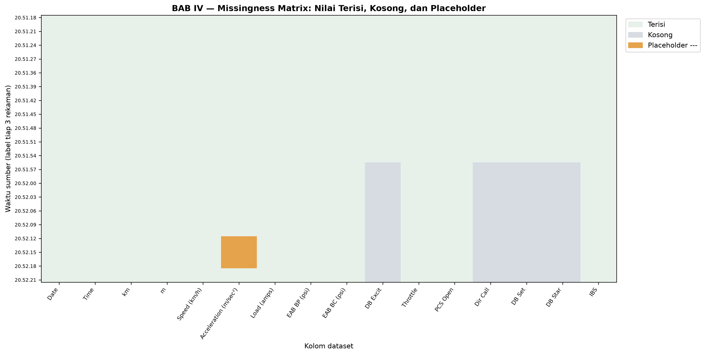
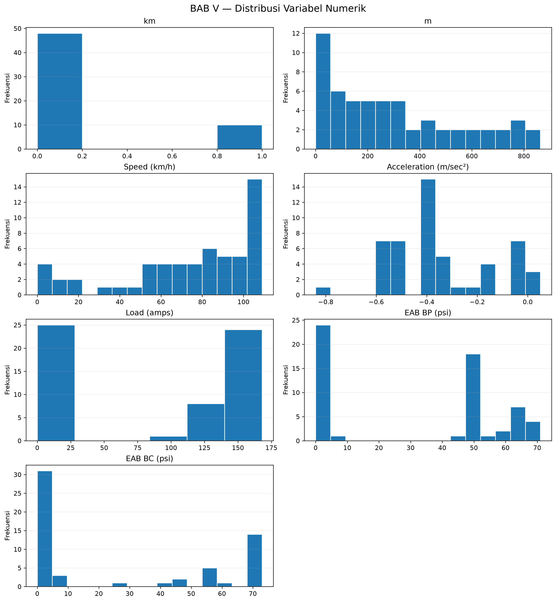

## Tujuan dan batas pembahasan

**Apa yang dapat dibaca dari rekaman Data Logger KA 4B pada cuplikan Tabel 6–10?**

- EDA deskriptif atas data yang ditranskripsikan dari laporan akhir KNKT.
- Fokus: kualitas data, perubahan parameter operasi, statistik, dan batas interpretasi.
- Bukan rekonstruksi kecelakaan menyeluruh dan bukan penetapan sebab atau tanggung jawab.

::: {.notes}
Buka presentasi dengan menjelaskan bahwa materi ini adalah penjelasan atas laporan EDA, bukan pengganti laporan akhir KNKT. Tekankan bahwa semua angka dan waktu mengikuti Tabel 6 sampai 10 sebagaimana ditranskripsikan. Analisis hanya mendeskripsikan rekaman yang tersedia dan bukan bukti tunggal penyebab kecelakaan.
:::

## Sumber data dan cakupan

- Sumber primer: Laporan Akhir KNKT **KNKT.26.04.03.02**, Tabel 6–10.
- Tabel tercetak menghasilkan **59 baris sumber**.
- Satu rekaman **20:51:43** tercantum identik pada Tabel 7 dan Tabel 8.
- Dataset analitis setelah deduplikasi: **58 rekaman unik × 16 kolom**.
- Tanggal: **27 April 2026**; rentang timestamp: **20:51:18–20:52:21**.
- Dataset adalah transkripsi tabel laporan, bukan ekspor mentah perangkat logger.

::: {.notes}
Jelaskan provenance: data diambil dari lima tabel, bukan ekspor perangkat. Jumlah baris sumber 59, tetapi satu baris 20:51:43 muncul identik di dua tabel. Untuk analisis gabungan, kemunculan identik dihitung satu kali sehingga menjadi 58 rekaman unik. Jangan menyebut 58 sebagai jumlah seluruh rekaman logger di luar cakupan tabel ini.
:::

## Struktur data: 16 kolom

| Kelompok | Kolom yang dipertahankan | Satuan / bentuk |
|---|---|---|
| Waktu & posisi | Date, Time, km, m | tanggal, waktu, komponen km dan m |
| Gerak | Speed, Acceleration | km/h; m/sec² |
| Traksi | Load | **amps (A)** |
| Pengereman | EAB BP, EAB BC | psi |
| Status | DB Excit, Throttle, PCS Open, Dir Call, DB Set, DB Star, IBS | kategori/teks |

- Nama, satuan, dan isi kolom mengikuti transkripsi sumber.
- km dan m ditampilkan sebagai dua kolom terpisah.
- Tidak membentuk variabel jarak turunan untuk presentasi ini.

::: {.notes}
Bacakan kelompok variabel dan satuan penting. Load adalah arus dalam ampere, bukan daya dalam kilowatt. Kolom km dan m dipertahankan sebagaimana dicetak; jangan menggabungkannya menjadi jarak menuju titik henti atau chainage absolut. Status disajikan sebagai kategori/teks.
:::

## Integritas waktu dan rekaman

- Cakupan timestamp: **20:51:18 sampai 20:52:21**.
- Tidak ada rekaman yang disajikan pada **20:51:28–20:51:33**.
- Gap enam detik dipertahankan; **tidak diinterpolasi**.
- Timestamp pada tabel digunakan sebagaimana dicetak.
- KNKT menjelaskan penyesuaian waktu logger **+2 detik** pada peristiwa tabrakan dengan CCTV KA 5568A sebagai master time; EDA tidak menerapkan koreksi ulang.

{fig-alt="Interval aktual antarrekaman"}

::: {.notes}
Grafik interval memperlihatkan jeda waktu aktual antartimestamp. Indeks baris tidak selalu berarti satu detik. Gap 20:51:28 sampai 20:51:33 bukan nilai yang hilang untuk diisi, melainkan tidak ada rekaman yang disajikan pada cuplikan tabel. KNKT menyatakan timestamp logger saat tabrakan disesuaikan +2 detik dengan CCTV KA 5568A sebagai master time. EDA mengikuti waktu pada tabel dan tidak melakukan koreksi ulang atau mengklaim sinkronisasi independen lintas-sumber.
:::

## Kualitas data: tiga keadaan berbeda

- **26 sel kosong** pada masing-masing kolom DB Excit, Dir Call, DB Set, DB Star: kolom tidak ditampilkan pada Tabel 9–10.
- **7 placeholder ---** pada Acceleration (m/sec²), pada 20:52:12–20:52:18.
- Placeholder dipertahankan di data mentah; hanya dikecualikan dari hitungan numerik akselerasi.
- Tidak ada imputasi, interpolasi, penghapusan kolom, atau pengisian nol.

{fig-alt="Matriks nilai terisi, kosong, dan placeholder" width="78%"}

::: {.notes}
Bedakan sel kosong struktural dengan placeholder. Empat kolom status tidak ditampilkan pada Tabel 9 dan 10, sehingga 26 sel kosong per kolom bukan bukti kegagalan sensor atau status tertentu. Tujuh tanda --- merupakan penanda eksplisit untuk akselerasi pada waktu 20:52:12 sampai 20:52:18. Jangan mengganti tanda tersebut dengan nol. Dalam statistik numerik akselerasi, tujuh placeholder dikecualikan sehingga n valid 51.
:::

## Ringkasan statistik numerik

| Variabel | n valid | Mean | Median | Std. deviasi | Min–maks |
|---|---:|---:|---:|---:|---:|
| Speed (km/h) | 58 | 73,638 | 82,5 | 33,077 | 0–109 |
| Acceleration (m/sec²) | 51 | -0,336 | -0,38 | 0,203 | -0,84–0,05 |
| Load (amps) | 58 | 86,345 | 136 | 76,730 | 0–168 |
| EAB BP (psi) | 58 | 31,897 | 49 | 28,264 | 0–71 |
| EAB BC (psi) | 58 | 26,000 | 2 | 31,191 | 0–73 |
| m | 58 | 300,483 | 244,5 | 256,768 | 0–863 |

::: {.notes}
Angka di slide ini disalin dari tabel statistik pada laporan main. Akselerasi memiliki 51 nilai numerik karena tujuh placeholder tidak dihitung. Arus tetap menggunakan satuan ampere. Statistik merangkum seluruh cuplikan, bukan nilai pada satu fase tertentu. Data merupakan runtun waktu dari satu kejadian, sehingga jangan menafsirkan ringkasan ini sebagai estimasi perilaku umum armada atau populasi.
:::

## Perubahan kecepatan terhadap waktu

{fig-alt="Kecepatan lokomotif terhadap timestamp sumber" width="94%"}

- Kecepatan maksimum: **109 km/jam** pada **20:51:20**.
- Pada timestamp tabrakan **20:52:12**: **40 km/jam**.
- Pada **20:52:19–20:52:21**: **0 km/jam**.

::: {.notes}
Arahkan perhatian pada urutan waktu dan nilai yang tercatat. Nilai maksimum 109 km/jam terjadi pada 20:51:20. Pada timestamp tabrakan yang digunakan laporan, 20:52:12, kecepatan tercatat 40 km/jam. Kecepatan pertama kali tercatat nol pada 20:52:19 dan tetap nol sampai 20:52:21. Grafik tidak boleh dibaca sebagai interpolasi kontinu di antara timestamp.
:::

## Tekanan Brake Pipe dan Brake Cylinder

{fig-alt="Tekanan EAB BP dan EAB BC terhadap waktu" width="94%"}

- BP: **71 psi** (20:51:18), **49 psi** (20:51:43–20:51:55), **0 psi** (20:52:00).
- BC: **70 psi** pada 20:52:00; maksimum **73 psi** pada 20:52:12.
- Pada 20:52:19: BP **0 psi**, BC **55 psi**.

::: {.notes}
Baca BP dan BC sebagai dua parameter tekanan dengan satuan psi. BP turun dari 71 psi pada awal cuplikan menjadi 49 psi pada rentang 20:51:43 sampai 20:51:55, lalu 0 psi pada 20:52:00. BC mencapai 70 psi pada 20:52:00 dan maksimum 73 psi pada 20:52:12. Saat lokomotif berhenti pada 20:52:19, BC tercatat 55 psi. Grafik menunjukkan nilai tabel, bukan penilaian apakah respons pengereman sesuai spesifikasi teknis.
:::

## Arus motor traksi dan status operasi

{fig-alt="Panel parameter operasi menurut waktu" width="94%"}

- Load adalah arus motor traksi dalam **ampere (A)**.
- Arus **168 A** tercatat pada 20:51:18–20:51:36.
- Pada 20:51:56 tercatat **104 A**; pada 20:51:57 menjadi **0 A** hingga rekaman terakhir.
- Throttle, PCS, dan IBS dibaca sesuai kategori sumber.

::: {.notes}
Tekankan satuan Load: ampere, bukan kW. Arus 168 A tercatat pada 20:51:18 sampai 20:51:36; 104 A pada 20:51:56; dan 0 A mulai 20:51:57 hingga akhir rekaman. Panel multi-parameter menggunakan skala berbeda pada setiap sumbu. Jangan membandingkan besar garis antar-panel tanpa memperhatikan satuan. Status kategori dijelaskan terpisah agar tidak menyamakan jumlah rekaman dengan durasi.
:::

## Frekuensi status kategorikal

| Variabel | Kategori dan frekuensi |
|---|---|
| Throttle (58) | T5 17; Idle 13; T7 11; Off 10; T4 4; T6 2; T1 1 |
| PCS Open (58) | Closed 32; Open 26 |
| IBS (58) | Rel 39; Appl 19 |
| DB Excit (32 tersedia) | Off 32 |
| Dir Call (32 tersedia) | For 32 |
| DB Set (32 tersedia) | No 32 |
| DB Star (32 tersedia) | No 32 |

{fig-alt="Frekuensi kategori status pada dataset"}

::: {.notes}
Jumlah frekuensi merangkum rekaman, bukan durasi status. Throttle memiliki tujuh kategori dengan frekuensi sebagaimana tabel. PCS dan IBS tersedia untuk 58 rekaman. Empat kolom DB Excit, Dir Call, DB Set, dan DB Star hanya tersedia pada 32 rekaman dari Tabel 6 sampai 8. Denominator 32 ini tidak boleh dianggap 58; sel kosong pada Tabel 9–10 tidak diberi kategori dugaan.
:::

## Akselerasi: placeholder bukan nol

- Tujuh timestamp **20:52:12–20:52:18** memuat **---**.
- Statistik numerik dihitung dari **51 nilai**, bukan 58.
- Nilai numerik kembali tersedia: **-0,84 m/sec²** pada 20:52:19; **-0,40** pada 20:52:20; **-0,15** pada 20:52:21.
- Keterangan KNKT tentang data kosong/tidak terbaca pada tabrakan adalah konteks sumber.

::: {.notes}
Jelaskan secara eksplisit bahwa tanda tiga strip adalah placeholder pada sumber, bukan nol dan bukan angka yang boleh diperkirakan. Tujuh placeholder muncul berurutan pada 20:52:12 hingga 20:52:18. Karena itu statistik akselerasi menggunakan 51 nilai numerik. Setelah rentang tersebut, tabel kembali mencatat -0,84 pada 20:52:19, -0,40 pada 20:52:20, dan -0,15 pada 20:52:21 m/sec². Uraian KNKT tentang sensor yang tidak terbaca merupakan konteks dari dokumen, bukan hasil pengukuran ulang EDA.
:::

## Tabrakan dan berhenti: dua timestamp

| Waktu | Speed | BP | BC | Load | Catatan |
|---|---:|---:|---:|---:|---|
| 20:52:12 | 40 km/jam | 0 psi | 73 psi | 0 A | Tabrakan; akselerasi --- |
| 20:52:19 | 0 km/jam | 0 psi | 55 psi | 0 A | Lokomotif berhenti |

- Selisih timestamp pada tabel: **7 detik**.
- KNKT menyebut titik tabrakan **km 28+915** dan titik berhenti **km 28+941**.
- Jarak 26 m tersebut berasal dari uraian KNKT; jangan menyamakan dengan interpretasi bebas kolom km/m.

::: {.notes}
Ini slide kunci untuk menghindari penyatuan dua peristiwa. Timestamp tabrakan adalah 20:52:12, dengan kecepatan 40 km/jam. Timestamp berhenti adalah 20:52:19, dengan kecepatan 0 km/jam. Tabel memisahkan keduanya tujuh detik. KNKT menyebut titik tabrakan km 28+915 dan titik berhenti km 28+941, berjarak 26 meter menurut uraian laporan. Nilai koordinat pada kolom km dan m tetap harus dibaca sebagaimana tabel, tidak direkayasa menjadi chainage absolut.
:::

## Distribusi dan bentuk data

{fig-alt="Distribusi variabel numerik" width="92%"}

- Skewness kecepatan: **-0,958**.
- Skewness akselerasi: **0,290** (n=51).
- Skewness bukan uji normalitas; sampel adalah cuplikan time-series satu kejadian.

::: {.notes}
Gunakan visual ini sebagai inspeksi distribusi empiris. Laporan mencatat skewness kecepatan -0,958 dan akselerasi 0,290. Jangan menyimpulkan distribusi normal atau tidak normal hanya dari skewness dan histogram. Sampel kecil, berurutan, dan berasal dari satu kejadian. Distribusi juga menghilangkan urutan temporal, sehingga perlu dibaca bersama grafik deret waktu.
:::

## Pemeriksaan pencilan IQR

{fig-alt="Pemeriksaan IQR variabel numerik" width="92%"}

- Tidak ditemukan kandidat IQR pada enam variabel numerik operasional.
- km: Q1=Q3=0, IQR=0; sepuluh nilai km=1 ditandai mekanis dan tidak dianggap pencilan operasional.
- Tidak adanya kandidat IQR **bukan** bukti operasi normal atau bebas anomali.

::: {.notes}
Metode yang digunakan adalah pagar Q1 dikurangi 1,5 IQR dan Q3 ditambah 1,5 IQR. Tidak ada kandidat pada enam variabel numerik operasional: m, kecepatan, akselerasi numerik, arus, BP, dan BC. Kolom km dikecualikan dari interpretasi operasional karena Q1 dan Q3 sama-sama nol sehingga IQR nol dan sepuluh nilai satu ditandai secara mekanis. Hasil nol kandidat tidak membuktikan sistem normal atau bebas anomali teknis.
:::

## Apa yang dapat dan tidak dapat disimpulkan?

**Didukung oleh data**
- Nilai dan perubahan parameter pada timestamp yang tercantum.
- Ringkasan statistik, frekuensi kategori, placeholder, gap, dan cakupan kolom.
- Pola deskriptif dalam subset Tabel 6–10.

**Tidak dibuktikan oleh EDA ini**
- Penyebab kecelakaan atau kontribusi kausal parameter.
- Kelalaian atau tanggung jawab individu/pihak.
- Chainage absolut atau jarak pengereman murni dari kolom km/m.
- Status persinyalan, komunikasi, ATP, atau perangkat lain tanpa bukti primer.

::: {.notes}
Slide ini merangkum batas epistemik. EDA dapat menyatakan apa yang tertulis dan pola apa yang tampak pada subset. EDA tidak dapat menentukan penyebab, kesalahan personel, atau tanggung jawab. Tidak ada klaim tentang ATP atau sistem proteksi lain kecuali konfigurasi dan log pemasangannya tersedia. Kolom posisi juga tidak boleh diubah menjadi jarak henti tanpa definisi sumber yang memadai.
:::

## Kebutuhan verifikasi dan data lanjutan

1. Verifikasi independen setiap sel transkripsi terhadap PDF sumber.
2. Pertahankan raw, salinan analisis, metadata, dan checksum secara terpisah.
3. Peroleh ekspor mentah logger dan dokumentasi konfigurasi perangkat.
4. Integrasikan bukti persinyalan/interlocking, komunikasi, CCTV, dan operasi dengan sinkronisasi waktu terdokumentasi.
5. Untuk kajian pengereman, kumpulkan parameter rangkaian, karakteristik rem, gradien, adhesi, dan waktu respons.
6. Jangan melatih model prediktif dari 58 rekaman satu kejadian untuk klaim generalisasi.

::: {.notes}
Sampaikan rekomendasi sebagai kebutuhan bukti, bukan asumsi bahwa bukti tersebut sudah tersedia. Prioritas awal adalah audit independen transkripsi dan menjaga data mentah. Untuk rekonstruksi lintas-sumber, dibutuhkan dokumentasi offset dan drift waktu. Untuk analisis pengereman, perlu data teknis tambahan seperti komposisi rangkaian, massa, gradien, kondisi adhesi, dan parameter rem. Dengan 58 rekaman dari satu kejadian, model prediktif yang digeneralisasi belum layak.
:::

## Pesan penutup

**EDA memberi deskripsi pola dari rekaman yang tersedia. Interpretasi harus tetap setara dengan kekuatan bukti.**

- 58 rekaman unik, 16 kolom, cakupan Tabel 6–10.
- Timestamp, satuan, placeholder, dan sel kosong dipertahankan sesuai sumber.
- Tabrakan (20:52:12) berbeda dari berhenti (20:52:19).
- Tidak ada kesimpulan sebab-akibat atau tanggung jawab dari EDA ini.

::: {.notes}
Tutup dengan mengulang empat prinsip: cakupan terbatas, nilai sumber dipertahankan, tabrakan dan berhenti adalah timestamp berbeda, dan EDA bukan penetapan sebab. Arahkan audiens ke laporan lengkap untuk tabel rinci, metode, dan katalog visualisasi. Ucapkan terima kasih dan buka sesi pertanyaan.
:::

## Referensi dan keterlacakan

- Komite Nasional Keselamatan Transportasi. (2026). *Laporan Akhir Investigasi KNKT.26.04.03.02*, Tabel 6–10, halaman tercetak 65–68, serta konteks kronologi pada Bab II.3 dan Lampiran 7.
- [Laporan EDA lengkap di repository](../reports/Laporan_EDA_KNKT_Bekasi_Timur.md)
- [Katalog visualisasi dan panduan interpretasi](../docs/KATALOG_VISUALISASI.md)

::: {.notes}
Rujukan utama adalah laporan akhir KNKT yang menjadi sumber transkripsi, khususnya Tabel 6 sampai 10. Laporan EDA repository berisi metodologi dan uraian yang lebih lengkap. Katalog visualisasi memberi panduan pembacaan dan batas interpretasi tiap gambar. Pastikan versi laporan yang digunakan audiens adalah versi main yang dirujuk oleh presentasi.
:::
