## Analisis Data Logger Lokomotif KA 4B

<div class="cover-subtitle">
Studi Kasus: Tabrakan KA 4B Argo Bromo Anggrek &amp; KA 5568A<br>
<span>Stasiun Bekasi Timur · 27 April 2026</span>
</div>

:::: {.columns gap="1.2em"}
::: {.column width="50%"}
<div class="info-panel">
<div class="panel-heading">▤ &nbsp; SUMBER DATA &amp; PARAMETER</div>

**Sumber data utama**

Rekaman teknis *Data Logger* lokomotif KA 4B dari Laporan Akhir KNKT **No. KNKT.26.04.03.02**.

<hr>

**Parameter yang dikaji**

- Waktu dan jarak
- Kecepatan dan akselerasi
- Arus motor traksi
- Tekanan rem (*BP* dan *BC*)
- Posisi *throttle*
- Indikator *PCS* dan status *IBS*

<div class="panel-visual-caption">DATA LOGGER · PARAMETER OPERASI · JEJAK WAKTU</div>
</div>
:::
::: {.column width="50%"}
<div class="info-panel">
<div class="panel-heading">◎ &nbsp; FOKUS ANALISIS</div>

**Fokus masalah — analitis, bukan komersial**

- Menelaah perubahan kecepatan, pengereman, dan kontrol traksi pada rentang waktu kejadian.
- Memastikan transkripsi data dari laporan dapat dibaca, diperiksa, dan dianalisis secara terstruktur.

<div class="validation-panel">
<div class="validation-title">✓ &nbsp; PRINSIP VALIDASI</div>
Data Logger hanyalah satu bukti teknis. Temuan wajib diuji silang (*cross-check*) dengan kronologi KNKT dan bukti independen lain sebelum menarik kesimpulan sebab-akibat.
</div>
</div>
:::
::::

::: {.notes}
Slide ini memperkenalkan objek dan batas analisis. Sumber utama adalah rekaman teknis Data Logger lokomotif KA 4B sebagaimana ditampilkan dalam Laporan Akhir KNKT nomor KNKT.26.04.03.02. Parameter yang ditelaah meliputi waktu, jarak, kecepatan, akselerasi, arus motor traksi, tekanan Brake Pipe (BP) dan Brake Cylinder (BC), posisi throttle, indikator PCS, serta status IBS. Fokusnya deskriptif dan analitis: memahami perubahan parameter sepanjang rentang waktu kejadian serta memastikan transkripsi dapat ditelusuri dan diperiksa. Data logger tidak berdiri sendiri dan tidak cukup untuk menetapkan sebab-akibat. Setiap interpretasi perlu diuji silang dengan kronologi KNKT dan bukti independen lain.
:::


## Tujuan Exploratory Data Analysis (EDA)

<div class="objective-layout">
  <div class="objective-grid">
    <div class="objective-card"><span class="objective-no">01</span><strong>Memahami dataset</strong><p>Mengidentifikasi struktur, cakupan, jumlah rekaman, variabel, dan rentang waktu.</p></div>
    <div class="objective-card"><span class="objective-no">02</span><strong>Mengaudit kualitas</strong><p>Memeriksa kelengkapan, konsistensi, tipe data, nilai kosong, placeholder, dan duplikasi.</p></div>
    <div class="objective-card"><span class="objective-no">03</span><strong>Mendeskripsikan dinamika</strong><p>Menelaah perubahan kecepatan, jarak, BP/BC, arus traksi, throttle, PCS, dan IBS.</p></div>
    <div class="objective-card"><span class="objective-no">04</span><strong>Mengeksplorasi pola</strong><p>Menyajikan statistik deskriptif dan visualisasi eksploratif yang sesuai.</p></div>
    <div class="objective-card"><span class="objective-no">05</span><strong>Menjaga batas interpretasi</strong><p>Membedakan hasil EDA dari pembuktian sebab-akibat atau kesimpulan investigasi teknis.</p></div>
    <div class="objective-card"><span class="objective-no">06</span><strong>Merumuskan bukti lanjutan</strong><p>Menetapkan kebutuhan integrasi data persinyalan, komunikasi, sarana, prasarana, dan faktor manusia.</p></div>
  </div>
  <div class="objective-visual">
    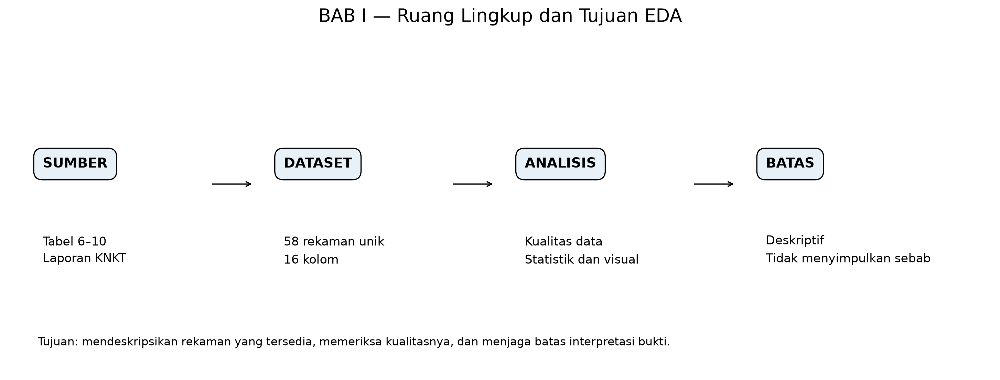
    <div class="objective-footnote"><strong>Prinsip utama</strong><br>Deskripsikan apa yang tercatat, uji konsistensi, lalu nyatakan keterbatasan sebelum menyusun interpretasi.</div>
  </div>
</div>

::: {.notes}
Tujuan EDA pada studi kasus ini terdiri atas enam bagian. Pertama, mengenali struktur dan cakupan dataset. Kedua, mengaudit kualitas transkripsi, termasuk nilai kosong, placeholder, tipe data, konsistensi, dan duplikasi. Ketiga, mendeskripsikan perubahan parameter operasi selama cuplikan waktu yang tersedia. Keempat, menyajikan pola dengan statistik deskriptif dan visualisasi. Kelima, menjaga agar hasil deskriptif tidak diperlakukan sebagai pembuktian sebab-akibat atau kesimpulan investigasi. Keenam, merumuskan kebutuhan integrasi bukti lanjutan, meliputi persinyalan, komunikasi, sarana, prasarana, dan faktor manusia. Tekankan bahwa tujuan keenam adalah kebutuhan penelitian lanjutan, bukan klaim bahwa semua data tersebut telah tersedia atau telah dianalisis.
:::

## Mengapa EDA dilakukan?

**EDA membantu kita memahami data sebelum mengambil keputusan atau membangun model.**

- Mengenali struktur, kualitas, distribusi, dan pola data.
- Menguji apakah data relevan untuk menjawab pertanyaan.
- Menemukan keterbatasan dan kebutuhan data tambahan.
- Mengomunikasikan temuan tanpa melampaui bukti.

::: {.notes}
Mulai dari gagasan utama: EDA bukan sekadar menjalankan fungsi statistik atau membuat grafik. EDA adalah proses sistematis untuk memahami apa yang direkam data, seberapa dapat dipercaya, pola apa yang terlihat, dan kesimpulan apa yang belum boleh dibuat. Gunakan seluruh presentasi sebagai panduan metodologis yang diterapkan secara kritis pada studi kasus Data Logger KA 4B.
:::

## Peta perjalanan: sembilan bab EDA

1. Pendahuluan & memahami masalah.
2. Memahami data.
3. Memuat & memeriksa data.
4. Menangani data yang hilang.
5. Mengeksplorasi karakteristik data.
6. Transformasi data.
7. Visualisasi hubungan data.
8. Menangani pencilan.
9. Menyampaikan temuan dan rekomendasi.

::: {.notes}
Jelaskan bahwa sembilan bab merupakan alur kerja yang saling terkait, bukan urutan kaku. Temuan kualitas data dapat membuat analis kembali ke tahap pengumpulan atau definisi masalah. Pada studi kasus KNKT, tujuan utamanya adalah EDA deskriptif, bukan membangun model prediktif.
:::

## Bab 1 — Pendahuluan & memahami masalah

Sebelum membuka dataset, jawab tiga pertanyaan:

- **Masalah:** keputusan atau pertanyaan apa yang ingin dijawab?
- **Tipe tugas:** klasifikasi, regresi, klasterisasi, atau analisis deskriptif?
- **Keberhasilan:** bukti apa yang menunjukkan analisis/model bermanfaat?

::: {.notes}
Tekankan bahwa jenis masalah ditentukan oleh pertanyaan dan target, bukan oleh algoritma yang ingin dipakai. Metrik juga harus sesuai tujuan. Jangan memaksakan akurasi atau F1-score jika tidak ada target klasifikasi.
:::

## 1.1 Latar belakang, masalah, dan tujuan

**Contoh bisnis:** mengidentifikasi pelanggan yang berisiko churn agar intervensi retensi tepat sasaran.

**Studi kasus KA 4B:**
- Pertanyaan: bagaimana parameter operasi tercatat berubah sepanjang cuplikan waktu?
- Tujuan: mendeskripsikan kualitas data, pola temporal, statistik, dan batas interpretasi.
- Bukan tujuan: menetapkan penyebab kecelakaan atau kesalahan pihak tertentu.

::: {.notes}
Bedakan contoh bisnis umum dengan kasus penelitian ini. Pada churn, keputusan bisnis yang dituju adalah intervensi pelanggan. Pada KA 4B, pertanyaan dibatasi pada deskripsi subset Tabel 6 sampai 10 laporan KNKT. Batas tujuan mencegah analisis berubah menjadi klaim kausal yang tidak didukung data.
:::

## 1.2 Tipe masalah: pilih sesuai target

| Tipe | Target/tujuan | Contoh |
|---|---|---|
| Klasifikasi | Kategori | Churn: ya/tidak |
| Regresi | Nilai kontinu | Prediksi harga rumah |
| Klasterisasi | Kelompok tanpa label | Segmentasi pelanggan |
| Deskriptif/EDA | Memahami data | Pola parameter terhadap waktu |

**Kasus KA 4B:** EDA deskriptif. Tidak ada target ML yang ditetapkan pada laporan ini.

::: {.notes}
Klasifikasi memprediksi kelas, regresi memprediksi angka kontinu, klasterisasi mencari kelompok berdasarkan kemiripan. EDA adalah kegiatan analisis yang dapat mendahului berbagai tugas tersebut, tetapi EDA sendiri tidak otomatis merupakan model klasifikasi, regresi, atau klasterisasi. Dataset KA 4B pada laporan ini tidak memiliki target prediksi yang didefinisikan.
:::

## 1.3 Metrik keberhasilan: model dan EDA berbeda

| Tujuan model | Metrik contoh |
|---|---|
| Klasifikasi | Precision, Recall, F1, ROC-AUC |
| Regresi | MAE, RMSE, R² |
| Klasterisasi | Silhouette Score + validasi domain |
| EDA | Keterlacakan, kualitas data, ketepatan hitung, relevansi temuan |

**Untuk KA 4B:** keberhasilan diukur dari reproduksibilitas transkripsi, konsistensi statistik, visual yang tepat, dan interpretasi yang proporsional.

::: {.notes}
Akurasi saja dapat menyesatkan pada kelas tidak seimbang. Untuk regresi, MAE mudah ditafsirkan dalam satuan target, sedangkan RMSE lebih menghukum galat besar. Untuk EDA, metrik model belum relevan. Ukur kualitas proses dan hasil analisis: semua angka dapat ditelusuri, satuan benar, perlakuan missing value transparan, dan tidak ada klaim di luar bukti.
:::

## Bab 2 — Memahami data

Sebelum analisis, bangun pemahaman tentang:

- Asal data dan cara data dikumpulkan.
- Makna setiap variabel, satuan, serta rentang waktunya.
- Struktur tabel dan statistik awal.
- Kualitas, keterbatasan, serta relevansi data terhadap pertanyaan.

::: {.notes}
Data tidak berdiri sendiri. Kita perlu mengetahui siapa yang menghasilkan data, bagaimana proses pencatatannya, apa arti setiap kolom, serta batas cakupannya. Dokumentasi sumber dan metadata merupakan bagian dari pemahaman data.
:::

## 2.1 Pengumpulan data: sumber, akses, ekstraksi

**Sumber umum:** database, CSV/XLSX, API, log perangkat, survei, atau web.

**Dokumentasikan:** pemilik/sumber, tanggal ekstraksi, versi, metode akses, izin, format, dan checksum.

**Kasus KA 4B:**
- Sumber primer: laporan akhir KNKT KNKT.26.04.03.02.
- Data ditranskripsikan dari Tabel 6–10, halaman tercetak 65–68.
- Dataset analitis bukan ekspor mentah perangkat logger.

::: {.notes}
Terangkan perbedaan sumber primer dengan artefak analisis. Dalam studi kasus ini sumbernya adalah dokumen PDF laporan KNKT, lalu tabel ditranskripsikan ke dataset. Jangan menyebutnya raw logger export. Praktik baiknya adalah menyimpan salinan sumber, mencatat halaman/tabel, memisahkan data mentah transkripsi dari data analisis, dan menghitung checksum agar perubahan dapat dilacak.
:::

## 2.2 Deskripsi dan eksplorasi awal

Periksa empat hal:

1. **Dimensi:** jumlah baris dan kolom.
2. **Tipe data:** integer, float, teks/kategori, datetime.
3. **Makna:** definisi kolom, unit, kode, dan rentang valid.
4. **Statistik awal:** mean, median, modus, simpangan baku, minimum, maksimum.

**Kasus KA 4B:** 59 baris tercetak; satu baris identik terulang; hasil deduplikasi 58 rekaman unik × 16 kolom.

::: {.notes}
Jelaskan bahwa statistik harus dibaca bersama definisi variabel. Nilai 100 dapat berarti 100 km/jam, 100 ampere, atau kode kategori, sehingga unit dan metadata sangat penting. Dalam kasus ini, 59 baris adalah jumlah kemunculan di tabel, sedangkan 58 adalah rekaman unik setelah satu duplikasi identik ditangani.
:::

## 2.3 Penilaian kualitas data

Periksa setidaknya:

- Missing values dan placeholder.
- Duplikasi baris atau kunci.
- Nilai ekstrem/outlier.
- Konsistensi kategori, format, unit, dan tanda.
- Rentang nilai yang masuk akal menurut domain.

**Jangan langsung menghapus atau mengubah nilai sebelum memahami penyebabnya.**

::: {.notes}
Kualitas data tidak hanya tentang null. Kesalahan unit, format waktu, duplikasi, kategori yang tidak konsisten, dan nilai yang mustahil juga penting. Penanganan harus didahului audit dan pengetahuan domain. Simpan jejak nilai asli dan semua keputusan pembersihan.
:::

## 2.4 Eksplorasi visual awal

- Histogram/KDE: bentuk distribusi variabel numerik.
- Bar chart: frekuensi kategori.
- Box plot: rentang dan nilai ekstrem.
- Scatter plot: pola dua variabel numerik.
- Heatmap: pola korelasi atau missingness.

**Kasus KA 4B:** grafik deret waktu lebih utama untuk membaca urutan perubahan parameter.

::: {.notes}
Pilih grafik sesuai pertanyaan. Histogram tidak menunjukkan urutan waktu. Scatter plot dapat membantu melihat hubungan dua parameter, sedangkan grafik deret waktu diperlukan untuk memahami perubahan dari satu timestamp ke timestamp berikutnya. Heatmap korelasi hanya relevan untuk variabel yang dapat dibandingkan secara matematis dan tidak membuktikan sebab-akibat.
:::

## 2.5 Penyelarasan data dengan kebutuhan

Tanyakan:

- Apakah variabel yang tersedia menjawab pertanyaan?
- Apakah periode dan jumlah observasi memadai?
- Apakah definisi dan unit konsisten?
- Data tambahan apa yang dibutuhkan?

**Kasus KA 4B:** 58 rekaman dari cuplikan satu kejadian cukup untuk deskripsi terbatas, bukan generalisasi perilaku armada atau pemodelan prediktif.

::: {.notes}
Data yang tersedia belum tentu data yang dibutuhkan. Untuk kajian sebab kecelakaan atau respons pengereman, misalnya, diperlukan sumber tambahan seperti ekspor logger mentah, konfigurasi perangkat, karakteristik rangkaian, gradien, adhesi, dan bukti lintas-sumber yang tersinkronisasi. Jangan menyimpulkan kebutuhan data tambahan sebagai bukti bahwa data tersebut sudah tersedia.
:::

## Bab 3 — Memuat & memeriksa data

Alur kerja Python yang umum:

```python
import pandas as pd
import numpy as np

df = pd.read_csv("dataset.csv")
print(df.head())
print(df.shape)
print(df.info())
print(df.describe(include="all"))
```

- Catat versi library dan sumber file.
- Pastikan parsing tanggal, angka, dan kategori benar.
- Jangan membagi train/test sebelum tujuan prediksi dan target ditetapkan.

::: {.notes}
Perkenalkan pandas sebagai alat membaca dan memeriksa tabel, serta NumPy untuk operasi numerik. Syntax hanyalah contoh, bukan klaim bahwa dataset KA 4B berasal dari CSV mentah. Untuk reproduksibilitas, simpan environment atau versi library. Pembagian train/test hanya diperlukan untuk tugas prediktif, bukan untuk EDA deskriptif murni.
:::

## 3.2–3.4 Inspeksi struktur dan ringkasan

| Perintah | Pertanyaan yang dijawab |
|---|---|
| df.head() | Apakah baris awal terbaca benar? |
| df.shape | Berapa baris dan kolom? |
| df.columns | Apa nama variabel? |
| df.info() | Apa tipe data dan nilai non-null? |
| df.describe() | Bagaimana ringkasan numeriknya? |
| value_counts() | Kategori apa yang dominan? |

**Kasus KA 4B:** verifikasi 16 kolom, 58 rekaman unik, dan unit setiap parameter sebelum menghitung statistik.

::: {.notes}
Tekankan bahwa df.info dan df.describe bukan audit otomatis yang menggantikan pengetahuan domain. Tipe object dapat berisi angka yang belum diparsing, sementara kode kategori tidak boleh diperlakukan sebagai ukuran numerik. Untuk kategori, gunakan frekuensi dan nilai unik. Untuk angka, cek minimum-maksimum dan unit.
:::

## Bab 4 — Penanganan data yang hilang

Urutan keputusan yang sehat:

1. Temukan lokasi dan jumlah nilai kosong.
2. Bedakan null, placeholder, dan data yang memang tidak dicatat.
3. Telusuri alasan kehilangan data.
4. Pilih penanganan berdasarkan tujuan dan domain.
5. Dokumentasikan dampak terhadap jumlah observasi.

::: {.notes}
Jangan mulai dari dropna atau fillna. Pertama pahami apa arti sel kosong. Nilai kosong struktural karena kolom tidak ditampilkan berbeda dengan sensor yang gagal membaca dan berbeda lagi dengan placeholder yang secara eksplisit dicetak sumber. Keputusan penanganan harus dapat dijelaskan.
:::

## 4.1 Identifikasi dan visualisasi missing values

Contoh pemeriksaan:

```python
missing_n = df.isna().sum()
missing_pct = df.isna().mean() * 100
```

Visualisasikan lokasi dan pola missingness dengan matriks atau bar chart.

**Kasus KA 4B:**
- Empat kolom status tidak ditampilkan pada Tabel 9–10.
- Masing-masing memiliki 26 sel kosong struktural.
- Acceleration memiliki tujuh placeholder `---`, bukan nilai nol.

{fig-alt="Matriks nilai terisi, kosong, dan placeholder" width="78%"}

::: {.notes}
Tunjukkan perbedaan visual antara sel yang tidak tersedia karena struktur tabel dan placeholder yang tercetak eksplisit. Empat kolom DB Excit, Dir Call, DB Set, DB Star tidak muncul di Tabel 9–10, sehingga 26 sel kosong per kolom bukan bukti kerusakan sensor. Tujuh tanda --- pada akselerasi berada pada 20:52:12 sampai 20:52:18. Jangan mengonversinya menjadi nol.
:::

## 4.2 Mekanisme missing data: MCAR, MAR, MNAR

- **MCAR:** peluang hilang tidak terkait variabel teramati maupun tidak teramati.
- **MAR:** peluang hilang terkait variabel yang teramati.
- **MNAR:** peluang hilang terkait nilai yang hilang itu sendiri atau mekanisme tak teramati.

Mekanisme tidak dapat dipastikan hanya dari heatmap atau persentase null.

**Kasus KA 4B:** sel kosong struktural dijelaskan oleh cakupan tabel; tujuh placeholder perlu dibaca sesuai keterangan sumber, bukan dipaksakan ke MCAR/MAR/MNAR tanpa bukti.

::: {.notes}
Jelaskan tiga mekanisme sebagai kerangka statistik. Pola visual dapat memberi petunjuk, tetapi tidak membuktikan mekanisme. Pengetahuan tentang proses pengumpulan dan dokumentasi sumber diperlukan. Pada dataset ini, missingness empat kolom status dapat dijelaskan secara struktural oleh tabel yang tidak memuat kolom tersebut, sehingga istilah missing value sensor tidak tepat.
:::

## 4.3–4.4 Eliminasi atau imputasi?

**Eliminasi:** drop baris/kolom hanya jika alasan kuat, dampak sampel dipahami, dan data yang dihapus tidak krusial.

**Imputasi:** mean/median/mode, KNN Imputer, atau MICE dapat dipertimbangkan jika asumsi dan tujuan mendukung.

Waspadai:
- Bias dan hilangnya variasi.
- Nilai sintetis yang tidak pernah diobservasi.
- Data leakage jika imputasi dilakukan sebelum pemisahan train/test.

**Kasus KA 4B:** tidak dilakukan dropna maupun imputasi; nilai sumber dipertahankan.

::: {.notes}
Mean sensitif terhadap pencilan, median lebih tahan pada distribusi miring, mode umum untuk kategori. Metode KNN dan MICE lebih kompleks dan memerlukan asumsi, fitur pendukung, serta validasi. Untuk prediksi, parameter imputasi harus dipelajari dari data training saja. Pada studi kasus, mengisi placeholder akselerasi dengan nol akan mengubah bukti, sehingga tidak dilakukan.
:::

## Bab 5 — Mengeksplorasi karakteristik data

Analisis numerik mencakup:

- Pemusatan: mean, median, modus.
- Penyebaran: standar deviasi, varians, rentang.
- Posisi: kuartil Q1, Q2, Q3 dan IQR.
- Bentuk distribusi: skewness dan kurtosis.

Selalu laporkan jumlah observasi valid (n) dan satuan.

::: {.notes}
Jelaskan mengapa satu ukuran tidak cukup. Mean dan median yang berbeda dapat mengisyaratkan kemiringan. Standar deviasi memberi gambaran penyebaran, sedangkan kuartil lebih tahan terhadap nilai ekstrem. n valid penting agar pembaca mengetahui berapa nilai yang benar-benar dihitung.
:::

## 5.1 Statistik deskriptif pada kasus KA 4B

| Variabel | n | Mean | Median | Std. deviasi | Min–maks |
|---|---:|---:|---:|---:|---:|
| Speed (km/h) | 58 | 73,638 | 82,5 | 33,077 | 0–109 |
| Acceleration (m/sec²) | 51 | -0,336 | -0,38 | 0,203 | -0,84–0,05 |
| Load (A) | 58 | 86,345 | 136 | 76,730 | 0–168 |
| EAB BP (psi) | 58 | 31,897 | 49 | 28,264 | 0–71 |
| EAB BC (psi) | 58 | 26,000 | 2 | 31,191 | 0–73 |

**Catatan:** Load (A) adalah arus dalam ampere, bukan daya (kW).

::: {.notes}
Arahkan audiens pada perbedaan jumlah nilai valid akselerasi, yaitu 51, karena tujuh placeholder tidak dihitung. Variabel lain memiliki 58 nilai pada ringkasan ini. Nilai statistik menggambarkan seluruh cuplikan, bukan kondisi pada satu fase tertentu. Satuan Load adalah ampere. Jangan menyebutnya daya atau kilowatt.
:::

## 5.2 Skewness, kurtosis, dan distribusi

- **Skewness ≈ 0:** relatif simetris; positif: ekor kanan; negatif: ekor kiri.
- **Kurtosis:** menggambarkan karakter ekor/keruncingan relatif terhadap distribusi acuan.
- Histogram dan KDE membantu inspeksi bentuk distribusi.
- Skewness/kurtosis bukan uji normalitas tunggal.

**Kasus KA 4B:** skewness Speed = -0,958; Acceleration = 0,290 (n=51).

{fig-alt="Distribusi variabel numerik" width="88%"}

::: {.notes}
Gunakan istilah secara hati-hati. Kurtosis yang dilaporkan sebagai excess kurtosis memiliki acuan nol untuk distribusi normal; pastikan definisi library atau laporan diketahui. Histogram dan KDE membantu melihat bentuk tetapi sensitif pada ukuran sampel dan pilihan bin/bandwidth. Cuplikan 58 rekaman berurutan dari satu kejadian tidak dapat dianggap sampel acak populasi. Jangan mengklaim normalitas hanya dari skewness.
:::

## Bab 6 — Transformasi data: kapan diperlukan?

Transformasi dapat membantu model atau analisis tertentu, tetapi bukan kewajiban setiap EDA.

- Mengurangi kemiringan distribusi.
- Menyamakan skala fitur.
- Mengubah kategori menjadi representasi yang dapat diproses model.
- Membuat fitur baru berdasarkan pengetahuan domain.

**Kasus KA 4B:** tidak dilakukan transformasi, scaling, encoding, atau feature engineering pada dataset analitis.

::: {.notes}
Jelaskan perbedaan EDA dengan preprocessing untuk pemodelan. Pada laporan KNKT, tujuan mempertahankan nilai dan satuan sumber. Karena itu, transformasi tidak diterapkan. Jika kelak ada model prediktif, transformasi harus dirancang sebagai pipeline yang sesuai target dan divalidasi.
:::

## 6.1 Transformasi distribusi dan skewness

Pilihan metode:
- Log atau log1p untuk nilai non-negatif, dengan perhatian pada nol.
- Square root untuk beberapa data hitungan.
- Box-Cox untuk nilai positif.
- Yeo-Johnson dapat menangani nol dan nilai negatif.

Bandingkan distribusi dan interpretasi sebelum/sesudah.

**Penting:** regresi linear tidak mensyaratkan semua fitur harus berdistribusi normal.

::: {.notes}
Koreksi miskonsepsi umum: asumsi normalitas pada inferensi regresi linear berkaitan terutama dengan residual untuk pengujian dan interval dalam kondisi tertentu, bukan syarat semua prediktor harus normal. Transformasi dapat membantu linearitas, heteroskedastisitas, atau stabilitas, tetapi bukan sekadar mengejar histogram berbentuk lonceng. Periksa interpretasi skala baru.
:::

## 6.2 Scaling: StandardScaler dan MinMaxScaler

| Metode | Hasil | Kegunaan umum |
|---|---|---|
| StandardScaler | mean 0, std 1 | PCA, SVM, regresi ter-regularisasi |
| MinMaxScaler | rentang target, sering 0–1 | KNN, K-Means, neural network |

- Scaling penting untuk metode berbasis jarak/gradien.
- Fit scaler pada training set; terapkan ke validation/test.
- Scaling tidak otomatis mengatasi pencilan.

::: {.notes}
Scaling membuat skala fitur sebanding, tetapi tidak menghapus perbedaan makna atau memperbaiki kualitas data. MinMax sensitif pada nilai ekstrem. StandardScaler juga dipengaruhi mean dan standar deviasi. Untuk menghindari leakage, fit transformasi hanya pada training data, lalu gunakan parameter yang sama pada data validasi dan test.
:::

## 6.3 Encoding kategori & 6.4 feature engineering

**Encoding**
- One-hot: kategori nominal tanpa urutan.
- Ordinal: kategori memiliki urutan yang bermakna.
- Hindari memberi urutan palsu pada kategori nominal.

**Feature engineering**
- Ekstraksi waktu: jam, hari, bulan.
- Rasio/agregasi yang bermakna.
- Binning dengan batas yang dapat dijelaskan.

**Kasus KA 4B:** kategori status dipertahankan untuk analisis frekuensi; tidak di-encode untuk model.

::: {.notes}
Label encoding pada kategori nominal dapat memberi kesan urutan palsu, misalnya warna merah=0, biru=1, hijau=2. One-hot lebih sesuai untuk nominal. Ordinal hanya untuk kategori dengan urutan nyata. Feature engineering harus menjaga makna domain dan menghindari kebocoran target. Pada studi kasus, status throttle, PCS, dan IBS dihitung frekuensinya tanpa mengubah kategori sumber.
:::

## Bab 7 — Visualisasi hubungan data

Gunakan visualisasi sesuai pertanyaan:

- Univariate: histogram, KDE, box plot, count plot.
- Bivariate: scatter plot, grouped box plot, violin plot.
- Multivariate: pairplot, heatmap, panel deret waktu.
- Korelasi/asosiasi: Pearson, Spearman, Cramér's V sesuai tipe data.

Visualisasi harus memiliki judul, satuan, label sumbu, legenda, dan sumber.

::: {.notes}
Visualisasi adalah alat untuk mengeksplorasi pola, bukan dekorasi. Pilih jenis grafik berdasarkan tipe variabel dan pertanyaan. Periksa skala sumbu, data yang hilang, dan jumlah observasi. Grafik yang bagus tetap dapat menyesatkan jika label atau satuannya salah.
:::

## 7.1 Analisis univariat

**Numerik:** histogram/KDE untuk bentuk distribusi; box plot untuk kuartil dan rentang.

**Kategorikal:** count plot/bar chart untuk jumlah dan proporsi kategori.

**Kasus KA 4B:** distribusi numerik dan frekuensi status menjelaskan karakteristik tiap variabel secara mandiri.

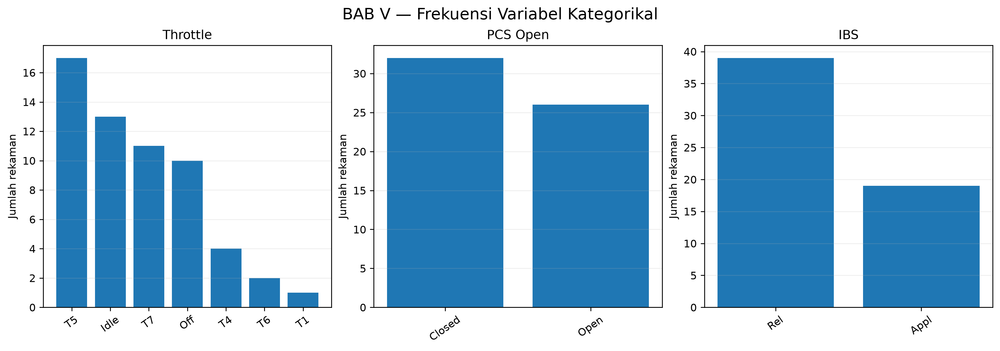{fig-alt="Frekuensi kategori status"}

::: {.notes}
Jelaskan perbedaan jumlah dan persentase. Frekuensi kategori throttle berjumlah 58, sementara empat kolom DB hanya memiliki 32 observasi karena tidak ditampilkan pada dua tabel terakhir. Jangan membandingkan frekuensi tanpa menyebut denominator. Untuk numerik, baca histogram bersama ringkasan statistik dan urutan waktunya.
:::

## 7.2 Analisis bivariat dan multivariat

- Numerik × numerik: scatter plot dan korelasi.
- Kategori × numerik: grouped box plot atau violin plot.
- Waktu × parameter: line chart dengan timestamp aktual.
- Multivariat: panel atau pairplot dengan perhatian pada skala dan kepadatan.

**Kasus KA 4B:** perubahan Speed, EAB BP, EAB BC, dan Load dibaca menurut timestamp.

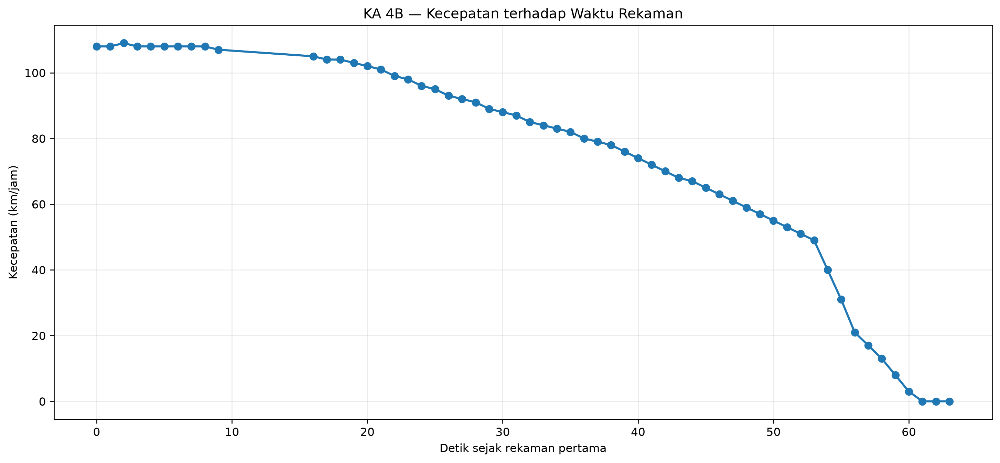{fig-alt="Kecepatan terhadap waktu" width="85%"}

::: {.notes}
Untuk data logger, waktu adalah dimensi penting. Grafik garis membantu membaca urutan pencatatan, tetapi jangan menghubungkan titik seolah-olah semua interval sama jika terdapat gap. Dalam cuplikan ini tidak ada rekaman pada 20:51:28 sampai 20:51:33; visual harus mempertahankan fakta tersebut dan tidak menginterpolasi.
:::

## 7.3 Korelasi dan asosiasi

- **Pearson:** kekuatan hubungan linear numerik.
- **Spearman:** hubungan monoton berbasis peringkat.
- **Cramér's V:** asosiasi antarvariabel kategorikal.
- Periksa multikolinearitas jika membangun model.

Korelasi bukan kausalitas. Hubungan dapat dipengaruhi waktu, faktor ketiga, atau struktur pengambilan sampel.

::: {.notes}
Jangan memilih Pearson hanya karena tersedia secara default. Periksa bentuk hubungan, pencilan, skala, dan asumsi. Spearman dapat menangkap hubungan monoton yang tidak linear. Cramér's V untuk kategori. Pada data berurutan waktu, korelasi dapat muncul karena tren bersama atau autokorelasi. Tidak satu pun dari ukuran ini membuktikan bahwa satu parameter menyebabkan parameter lain berubah.
:::

## Bab 8 — Penanganan pencilan

Deteksi pencilan adalah langkah investigasi, bukan perintah otomatis untuk menghapus data.

- IQR: batas Q1 − 1,5×IQR dan Q3 + 1,5×IQR.
- Z-score: jarak dari mean dalam satuan standar deviasi.
- Periksa box plot/scatter plot dan validitas domain.
- Putuskan: koreksi, hapus, capping, transformasi, atau pertahankan.

::: {.notes}
IQR relatif tahan terhadap distribusi miring. Z-score sensitif terhadap mean dan standar deviasi sehingga lebih sesuai pada kondisi distribusi yang mendekati normal dan tanpa pencilan berat. Nilai ekstrem dapat merupakan kejadian nyata, bukan kesalahan. Keputusan perlakuan harus didokumentasikan.
:::

## 8.1–8.2 Deteksi dan keputusan perlakuan

| Strategi | Kapan dipertimbangkan |
|---|---|
| Trimming | Terbukti kesalahan/artefak yang tak dapat dipulihkan |
| Capping | Perlu membatasi pengaruh ekstrem dengan alasan kuat |
| Transformasi | Bentuk distribusi atau hubungan perlu diperbaiki |
| Retention | Nilai valid dan penting bagi fenomena |

**Kasus KA 4B:** tidak ada kandidat IQR pada enam variabel numerik operasional. Sepuluh nilai `km=1` ditandai mekanis karena IQR=0 dan tidak dianggap pencilan operasional.

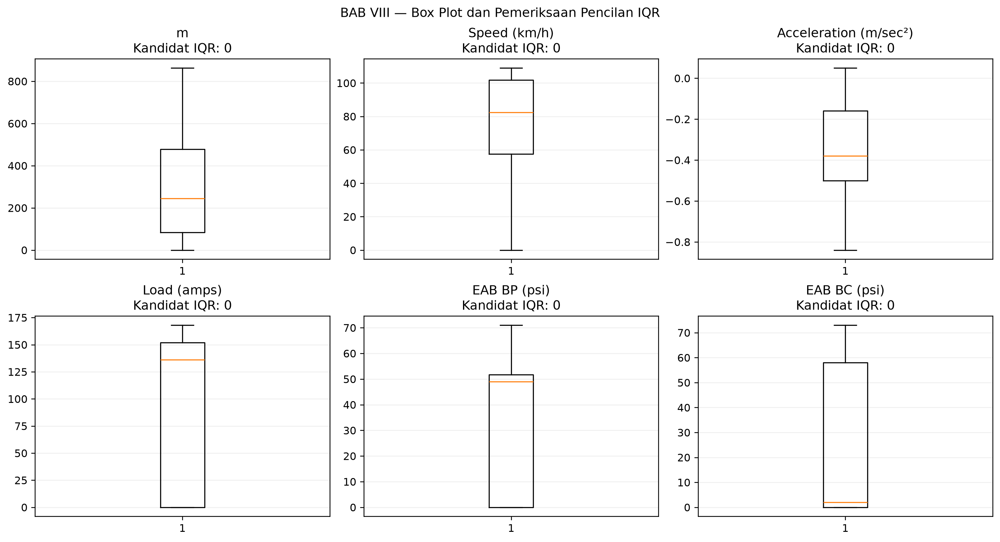{fig-alt="Pemeriksaan IQR" width="88%"}

::: {.notes}
Jelaskan hasil sesuai laporan: tidak ada kandidat IQR pada enam variabel numerik operasional. Kolom km memiliki Q1=Q3=0 sehingga IQR nol; sepuluh nilai satu terdeteksi secara mekanis, tetapi kolom ini dikecualikan dari interpretasi pencilan operasional. Hasil tidak berarti data bebas anomali, dan tidak membuktikan operasi normal. Nilai sumber dipertahankan.
:::

## Bab 9 — Komunikasi temuan dan insight

Laporan akhir sebaiknya menjawab:

1. Pola utama apa yang didukung data?
2. Anomali atau hal yang perlu diverifikasi apa yang ditemukan?
3. Apa keterbatasan analisis?
4. Data atau analisis lanjutan apa yang dibutuhkan?
5. Apa rekomendasi yang sebanding dengan bukti?

::: {.notes}
Komunikasi hasil bukan hanya memajang grafik. Pilih temuan yang relevan dengan pertanyaan, sertakan nilai dan waktu pendukung, jelaskan keterbatasan, dan hindari bahasa kausal jika desain analisis hanya deskriptif. Rekomendasi harus dapat ditindaklanjuti.
:::

## 9.1 Temuan utama: kasus KA 4B

- Dataset analitis: **58 rekaman unik × 16 kolom**.
- Gap waktu 20:51:28–20:51:33 dipertahankan tanpa interpolasi.
- Tabrakan tercatat pada 20:52:12 dengan Speed 40 km/jam dan EAB BC 73 psi.
- Berhenti tercatat pada 20:52:19 dengan Speed 0 km/jam.
- Acceleration memiliki tujuh placeholder `---` pada 20:52:12–20:52:18.

::: {.notes}
Ini adalah temuan deskriptif yang dapat ditelusuri ke tabel. Bedakan tabrakan dan berhenti sebagai dua timestamp. KNKT menyebut titik tabrakan km 28+915 dan titik berhenti km 28+941; jarak 26 meter berasal dari uraian KNKT, bukan hasil mengolah kolom km/m secara bebas. Jangan menambahkan kesimpulan sebab-akibat.
:::

## 9.2 Keterbatasan dan kendala

- Hanya subset Tabel 6–10, bukan ekspor mentah logger.
- 58 rekaman unik dari satu kejadian dan rentang sekitar satu menit.
- Empat kolom status tidak tersedia pada Tabel 9–10.
- Tujuh placeholder akselerasi tidak menjadi nilai numerik.
- Sinkronisasi waktu mengikuti penjelasan KNKT; tidak dikalibrasi ulang oleh EDA.

::: {.notes}
Keterbatasan bukan kelemahan yang harus disembunyikan. Ini adalah informasi agar pembaca memahami validitas kesimpulan. Dataset tidak cukup untuk generalisasi armada atau klaim model prediktif. Untuk analisis lanjutan, diperlukan ekspor mentah dan integrasi bukti lain dengan ketidakpastian waktu yang terdokumentasi.
:::

## 9.3 Rekomendasi langkah berikutnya

**Sebelum pemodelan:**
- Verifikasi transkripsi dan dokumentasikan provenance.
- Dapatkan data tambahan dan definisikan target yang sah.
- Rancang fitur sesuai domain dan cegah data leakage.
- Tentukan baseline, pembagian data, dan metrik evaluasi.
- Pilih model setelah memahami struktur data.

**Jangan merekomendasikan algoritma hanya dari histogram atau korelasi.**

::: {.notes}
Linear Regression, Logistic Regression, Random Forest, XGBoost, SVM, atau KNN bukan pilihan yang dapat ditetapkan hanya dari EDA singkat. Pemilihan memerlukan definisi target, jumlah data, desain validasi, biaya kesalahan, ketidakseimbangan kelas, serta baseline. SMOTE hanya dipertimbangkan pada klasifikasi dengan ketidakseimbangan kelas dan harus diterapkan pada training fold saja, bukan seluruh dataset.
:::

## Ringkasan: EDA yang dapat dipertanggungjawabkan

**Pahami masalah → pahami sumber → periksa struktur → audit kualitas → eksplorasi → transformasi bila perlu → visualisasikan → evaluasi pencilan → komunikasikan temuan.**

- Pertahankan data asli dan jejak setiap keputusan.
- Bedakan fakta, hasil hitung, interpretasi, dan hipotesis.
- Jangan mengubah nilai tanpa alasan yang dapat diuji.
- Jangan membuat klaim lebih besar daripada kekuatan data.

::: {.notes}
Akhiri dengan pesan bahwa EDA yang baik bukan EDA yang melakukan sebanyak mungkin transformasi. EDA yang baik adalah analisis yang menjawab pertanyaan dengan transparan, dapat direproduksi, dan menjaga makna data. Dalam kasus KNKT, justru keputusan untuk tidak mengimputasi, tidak menginterpolasi, dan tidak mentransformasi data merupakan bagian penting dari integritas analisis.
:::

## Referensi dan keterlacakan

- Komite Nasional Keselamatan Transportasi. (2026). *Laporan Akhir Investigasi KNKT.26.04.03.02*, Tabel 6–10, halaman tercetak 65–68, serta konteks kronologi pada Bab II.3 dan Lampiran 7.
- [Laporan EDA lengkap di repository](../reports/Laporan_EDA_KNKT_Bekasi_Timur.md)
- [Katalog visualisasi](../docs/KATALOG_VISUALISASI.md)

::: {.notes}
Arahkan audiens ke laporan EDA untuk tabel, metodologi, dan angka yang lebih lengkap. Sumber utama data adalah laporan akhir KNKT. Setiap pembaruan presentasi harus dibangun ulang dari sumber dan angka yang diverifikasi, bukan disalin manual dari versi slide sebelumnya.
:::


## Lampiran visual 1 — Memahami masalah & tujuan

<div class="visual-gallery">
<figure>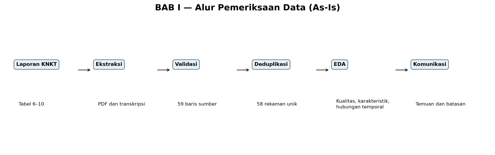<figcaption>alur pemeriksaan data</figcaption></figure>
<figure>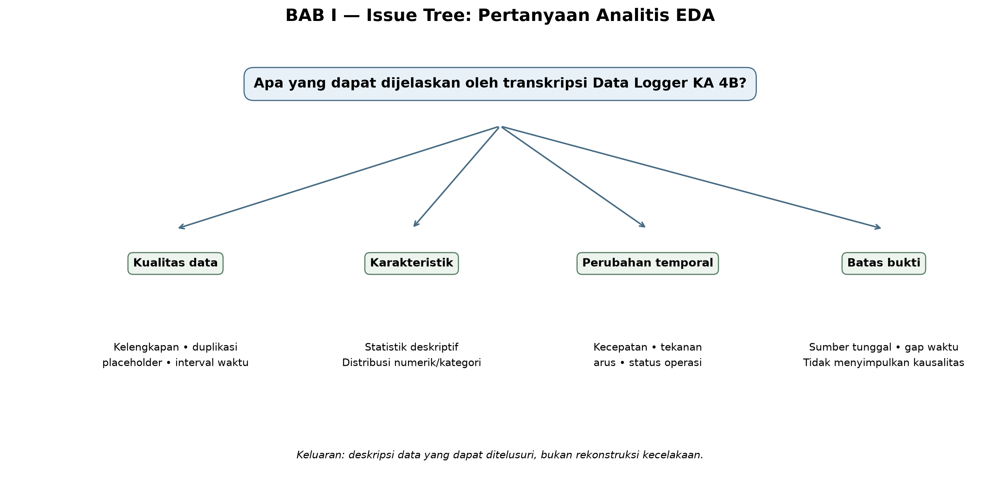<figcaption>issue tree pertanyaan eda</figcaption></figure>
<figure>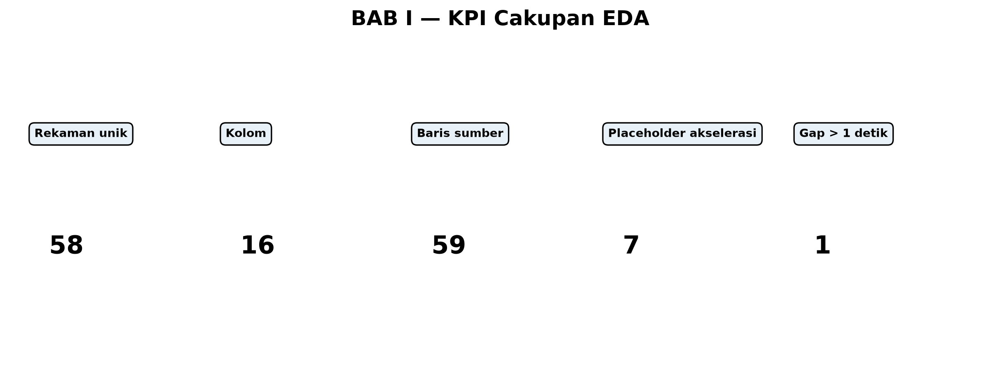<figcaption>kpi cakupan eda</figcaption></figure>
<figure><figcaption>ruang lingkup eda</figcaption></figure>
</div>

::: {.notes}
Visual pendukung dari direktori outputs repositori. Gambar ditampilkan sebagai bahan penelusuran tambahan; interpretasi substantif tetap mengikuti uraian dan batasan pada slide utama.
:::


## Lampiran visual 2 — Memahami data

<div class="visual-gallery">
<figure>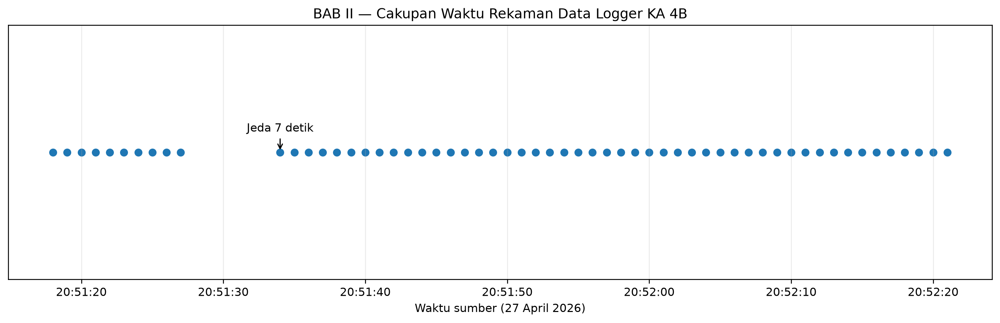<figcaption>cakupan waktu rekaman</figcaption></figure>
<figure><figcaption>matriks data ke pertanyaan</figcaption></figure>
<figure><figcaption>pipeline akuisisi data</figcaption></figure>
<figure><figcaption>ringkasan skema dataset</figcaption></figure>
</div>

::: {.notes}
Visual pendukung dari direktori outputs repositori. Gambar ditampilkan sebagai bahan penelusuran tambahan; interpretasi substantif tetap mengikuti uraian dan batasan pada slide utama.
:::


## Lampiran visual 3 — Memuat & memeriksa data

<div class="visual-gallery">
<figure>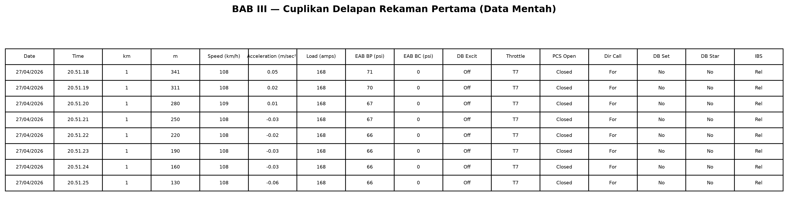<figcaption>cuplikan data mentah</figcaption></figure>
<figure>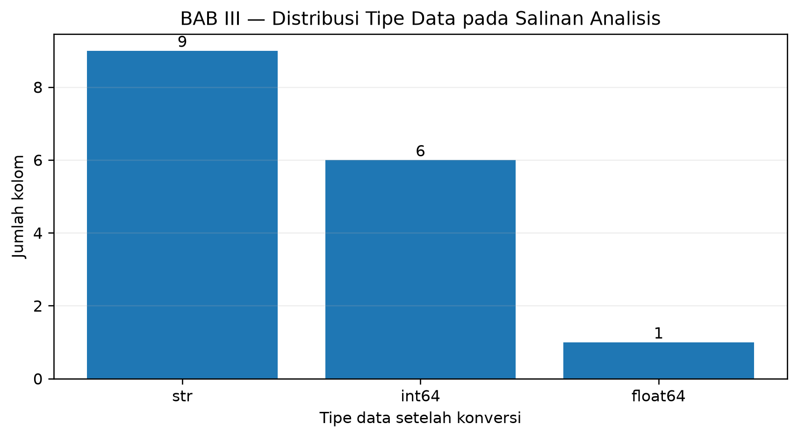<figcaption>distribusi tipe data raw</figcaption></figure>
<figure>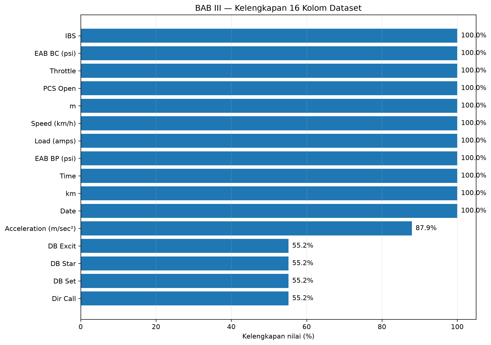<figcaption>kelengkapan kolom</figcaption></figure>
<figure><figcaption>rentang minimum maksimum</figcaption></figure>
</div>

::: {.notes}
Visual pendukung dari direktori outputs repositori. Gambar ditampilkan sebagai bahan penelusuran tambahan; interpretasi substantif tetap mengikuti uraian dan batasan pada slide utama.
:::


## Lampiran visual 4 — Kualitas & missing data

<div class="visual-gallery">
<figure><figcaption>scorecard struktur dataset</figcaption></figure>
<figure>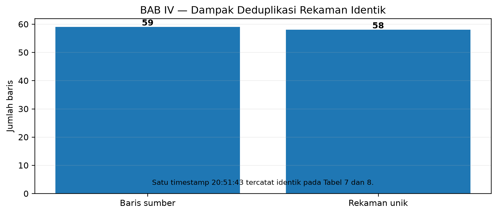<figcaption>dampak deduplikasi</figcaption></figure>
<figure>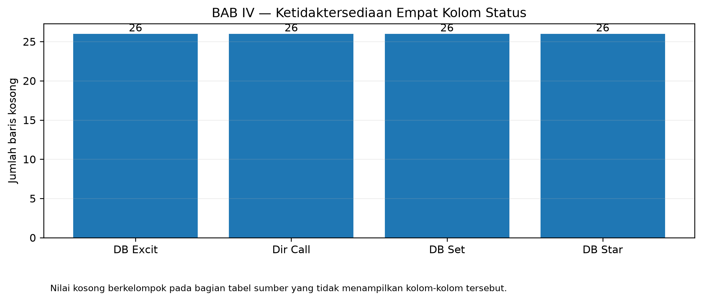<figcaption>missingness kolom status</figcaption></figure>
<figure><figcaption>missingness matrix</figcaption></figure>
</div>

::: {.notes}
Visual pendukung dari direktori outputs repositori. Gambar ditampilkan sebagai bahan penelusuran tambahan; interpretasi substantif tetap mengikuti uraian dan batasan pada slide utama.
:::


## Lampiran visual 5 — Karakteristik data

<div class="visual-gallery">
<figure>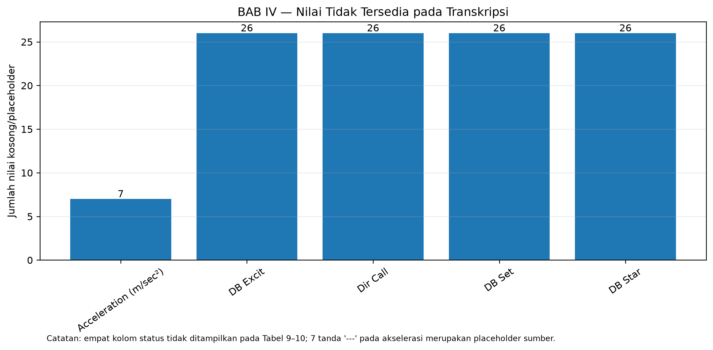<figcaption>missingness per kolom</figcaption></figure>
<figure><figcaption>boxplot mean median</figcaption></figure>
<figure><figcaption>distribusi numerik</figcaption></figure>
<figure><figcaption>ecdf variabel numerik</figcaption></figure>
</div>

::: {.notes}
Visual pendukung dari direktori outputs repositori. Gambar ditampilkan sebagai bahan penelusuran tambahan; interpretasi substantif tetap mengikuti uraian dan batasan pada slide utama.
:::


## Lampiran visual 6 — Transformasi & waktu

<div class="visual-gallery">
<figure><figcaption>frekuensi kategorikal</figcaption></figure>
<figure>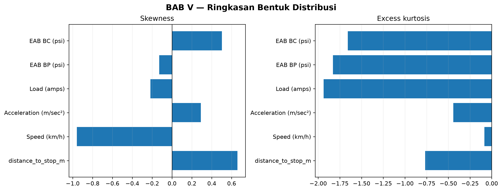<figcaption>skewness kurtosis</figcaption></figure>
<figure><figcaption>alur transformasi aktual</figcaption></figure>
<figure>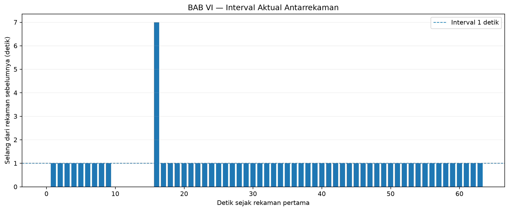<figcaption>interval temporal</figcaption></figure>
</div>

::: {.notes}
Visual pendukung dari direktori outputs repositori. Gambar ditampilkan sebagai bahan penelusuran tambahan; interpretasi substantif tetap mengikuti uraian dan batasan pada slide utama.
:::


## Lampiran visual 7 — Hubungan parameter

<div class="visual-gallery">
<figure>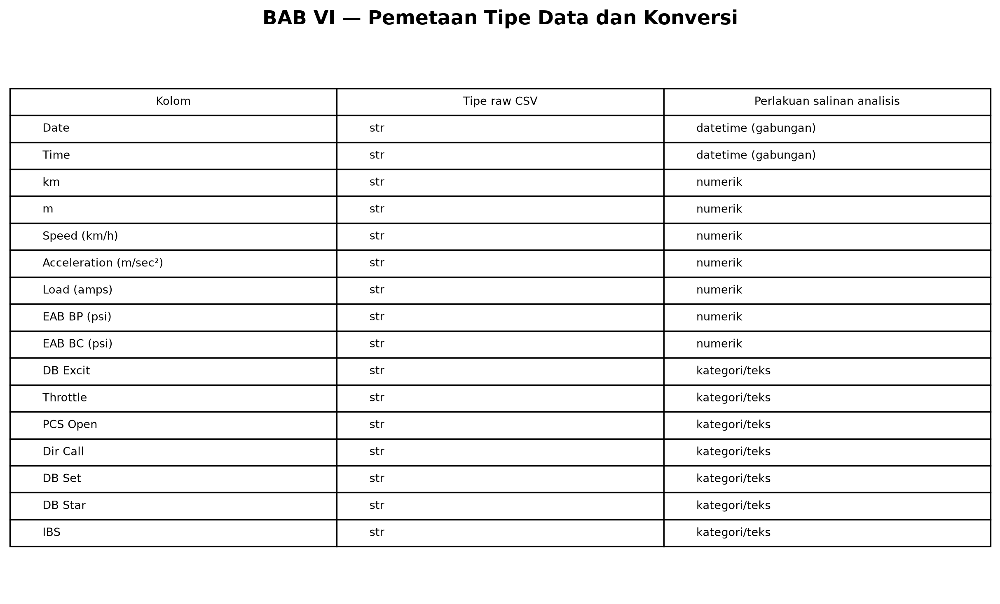<figcaption>pemetaan tipe dan konversi</figcaption></figure>
<figure>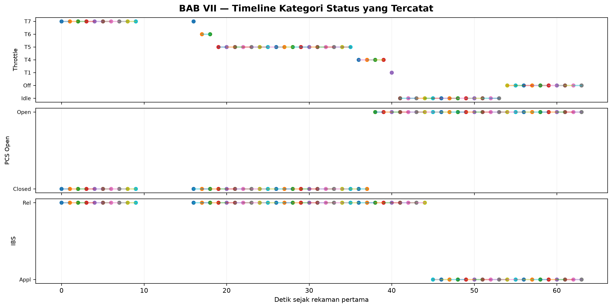<figcaption>categorical state timeline</figcaption></figure>
<figure><figcaption>grafik kecepatan waktu</figcaption></figure>
<figure><figcaption>heatmap spearman</figcaption></figure>
</div>

::: {.notes}
Visual pendukung dari direktori outputs repositori. Gambar ditampilkan sebagai bahan penelusuran tambahan; interpretasi substantif tetap mengikuti uraian dan batasan pada slide utama.
:::


## Lampiran visual 8 — Pencilan & konteks

<div class="visual-gallery">
<figure>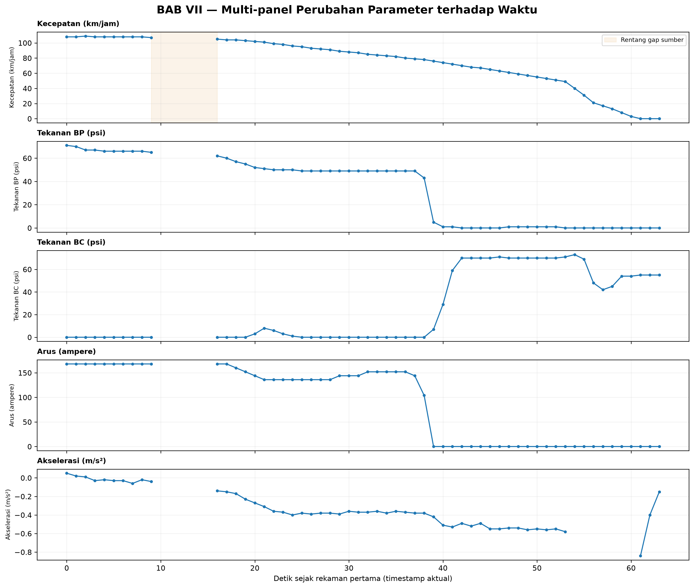<figcaption>multi panel parameter waktu</figcaption></figure>
<figure>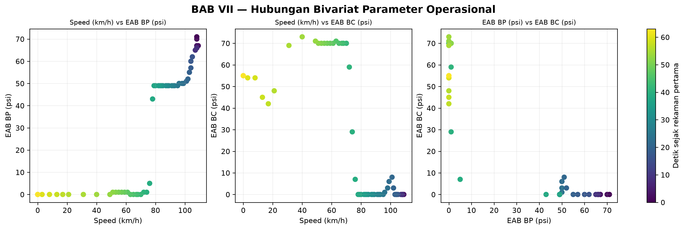<figcaption>scatter hubungan parameter</figcaption></figure>
<figure>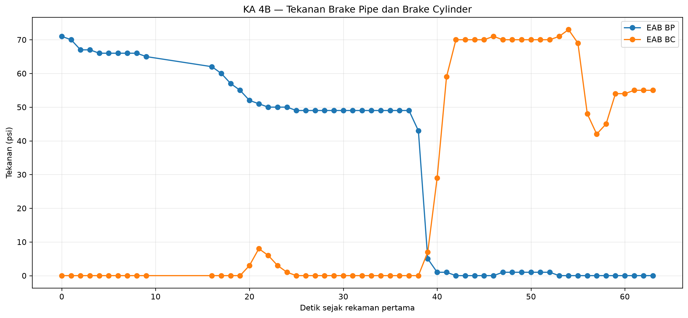<figcaption>tekanan bp bc waktu</figcaption></figure>
<figure><figcaption>boxplot iqr</figcaption></figure>
</div>

::: {.notes}
Visual pendukung dari direktori outputs repositori. Gambar ditampilkan sebagai bahan penelusuran tambahan; interpretasi substantif tetap mengikuti uraian dan batasan pada slide utama.
:::


## Lampiran visual 9 — Temuan & bukti lanjutan

<div class="visual-gallery">
<figure>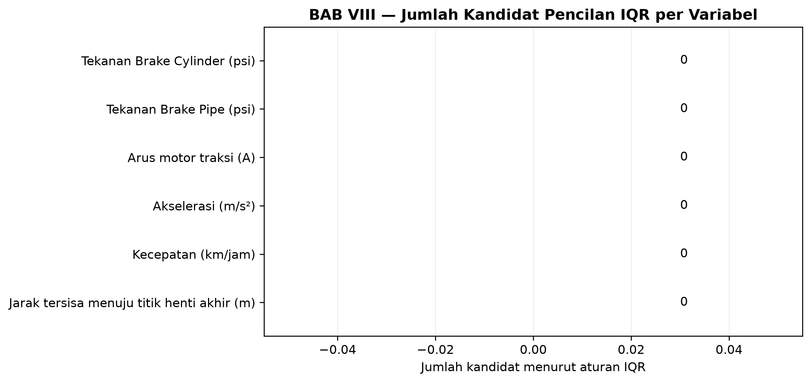<figcaption>jumlah kandidat iqr</figcaption></figure>
<figure><figcaption>konteks temporal parameter</figcaption></figure>
<figure>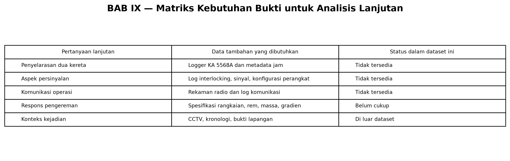<figcaption>decision matrix bukti lanjutan</figcaption></figure>
<figure>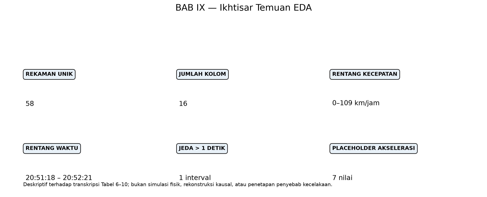<figcaption>ikhtisar temuan</figcaption></figure>
</div>

::: {.notes}
Visual pendukung dari direktori outputs repositori. Gambar ditampilkan sebagai bahan penelusuran tambahan; interpretasi substantif tetap mengikuti uraian dan batasan pada slide utama.
:::


## Lampiran visual 10 — Temuan & bukti lanjutan

<div class="visual-gallery">
<figure>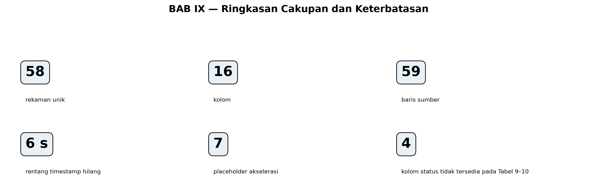<figcaption>scorecard keterbatasan</figcaption></figure>
<figure>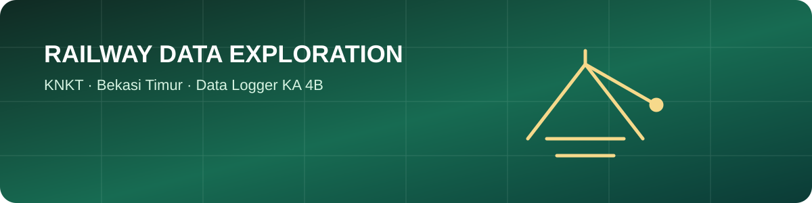<figcaption>hero</figcaption></figure>
</div>

::: {.notes}
Visual pendukung dari direktori outputs repositori. Gambar ditampilkan sebagai bahan penelusuran tambahan; interpretasi substantif tetap mengikuti uraian dan batasan pada slide utama.
:::
