# LAPORAN EXPLORATORY DATA ANALYSIS (EDA)
## Rekaman Data Logger Lokomotif KA 4B pada Fase Pengereman hingga Tabrakan dan Berhenti di Stasiun Bekasi Timur

**Mata Kuliah:** Exploratory Data Analysis  
**Program Studi:** Magister Ilmu Komputer, Universitas Amikom Purwokerto  
**Penyusun:** Muhammad Za’iimun Nasyiith  
**Sumber utama:** Laporan Akhir Investigasi KNKT Nomor KNKT.26.04.03.02  
**Tanggal penyusunan:** 26 November 2026

> **Pernyataan ruang lingkup.** Analisis empiris menggunakan transkripsi Tabel 6, 7, 8, 9, dan 10. Terdapat 59 baris sumber; satu rekaman pukul 20:51:43 tercantum identik pada Tabel 7 dan Tabel 8 sehingga dataset gabungan deduplikasi memuat 58 rekaman unik dan 16 kolom. Rentang waktu tercatat 20:51:18–20:52:21, dengan celah rekaman 20:51:28–20:51:33. Empat kolom pada Tabel 9–10 tidak ditampilkan dan tetap kosong untuk 26 rekaman dari dua tabel tersebut.

---

# BAB I. PENDAHULUAN DAN PEMAHAMAN PERMASALAHAN (UNDERSTANDING THE PROBLEM)

## 1.1 Latar Belakang Masalah dan Tujuan Utama

Laporan Akhir Investigasi KNKT Nomor KNKT.26.04.03.02 membahas tabrakan antara KA 4B Argo Bromo Anggrek dan KA 5568A Commuter Line di Jalur 1 Stasiun Bekasi Timur pada 27 April 2026. Salah satu sumber informasi teknis dalam laporan adalah rekaman Data Logger lokomotif KA 4B. Data Logger merekam sejumlah parameter operasi, antara lain waktu, jarak, kecepatan, akselerasi, arus motor traksi, tekanan Brake Pipe (BP), tekanan Brake Cylinder (BC), posisi throttle, indikator PCS, dan status Independent Brake System (IBS).

Permasalahan yang dikaji dalam proyek ini bukan persoalan komersial seperti kehilangan pelanggan atau prediksi harga. Permasalahan analitisnya adalah bagaimana mendeskripsikan dan menelaah perubahan parameter operasi lokomotif KA 4B pada rentang waktu yang disajikan, khususnya kecepatan, parameter pengereman, dan kontrol traksi, serta memastikan bahwa data yang ditranskripsikan dari laporan investigasi dapat dibaca, diperiksa, dan dianalisis secara terstruktur. Dalam perspektif investigasi kecelakaan, Data Logger merupakan satu sumber bukti teknis; interpretasinya harus diuji silang dengan kronologi KNKT dan bukti independen lain sebelum digunakan untuk menyimpulkan urutan sebab-akibat.

Tujuan EDA adalah:
1. Mengidentifikasi struktur dan cakupan dataset Data Logger yang digunakan.
2. Memeriksa kelengkapan, konsistensi, tipe data, nilai kosong, placeholder, dan duplikasi.
3. Mendeskripsikan perubahan kecepatan, jarak, tekanan BP/BC, arus motor traksi, throttle, PCS, dan IBS selama cuplikan waktu yang tersedia.
4. Menyajikan pola melalui statistik deskriptif dan visualisasi eksploratif.
5. Menetapkan batas interpretasi agar hasil EDA tidak disamakan dengan pembuktian sebab-akibat atau kesimpulan investigasi teknis.
6. Menyusun kebutuhan integrasi bukti lanjutan untuk rekonstruksi kejadian yang tersinkronisasi, termasuk data persinyalan, komunikasi, sarana, prasarana, dan faktor manusia.

## 1.2 Tipe Masalah

Proyek ini merupakan **Exploratory Data Analysis (EDA) deskriptif terhadap data runtun waktu (time-series)**. Dalam konteks investigasi, analisis ini merupakan tahap *data understanding* dan *preliminary event-pattern analysis*, bukan rekonstruksi kecelakaan menyeluruh dan bukan penetapan penyebab. Proyek ini tidak ditetapkan sebagai klasifikasi, regresi, maupun klasterisasi karena belum terdapat variabel target dan tujuan prediksi yang dirumuskan.

EDA digunakan untuk memahami data dan membangun pertanyaan analitis lanjutan. Penerapan model Machine Learning bukan sasaran wajib pada tahap ini. Pemaksaan algoritma klasifikasi atau regresi tanpa target yang sahih justru berisiko menghasilkan analisis yang tidak sesuai dengan tujuan penelitian.

**Gambar 1.1. Ruang lingkup dan alur EDA**

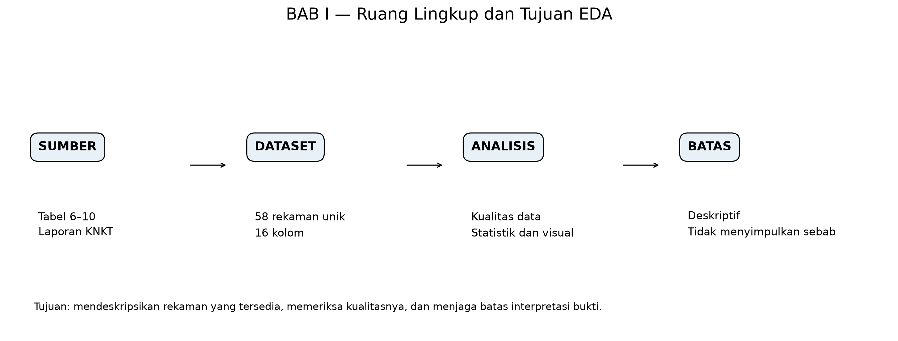

Sumber: hasil olah penulis berdasarkan cakupan Tabel 6–10 laporan KNKT.

## 1.3 Metrik Keberhasilan

Karena proyek ini tidak membangun model prediktif, akurasi, precision, recall, F1-score, MAE, dan RMSE belum relevan sebagai metrik keberhasilan. Keberhasilan EDA dinilai melalui kriteria kualitas, keterlacakan, dan reproduksibilitas berikut:
- Asal data dan halaman sumber dapat ditelusuri.
- Struktur dataset yang digunakan konsisten, yaitu 58 baris unik dan 16 kolom untuk cakupan Tabel 6–10.
- Nilai asli, termasuk penanda `---`, tidak diubah tanpa dasar.
- Nilai kosong struktural dibedakan dari penanda data sensor yang tidak terbaca.
- Proses pemuatan dengan Pandas berhasil dan dapat diulang.
- Statistik dan visualisasi dapat dihasilkan kembali dari berkas dataset yang sama.
- Setiap interpretasi dibatasi pada rekaman yang tersedia dan konteks yang dijelaskan dalam laporan KNKT.
- Tidak ada klaim sinkronisasi lintas-sumber, analisis ATP/interlocking, perhitungan jarak henti, atau penilaian faktor manusia tanpa bukti primer yang relevan.

---

# BAB II. MEMAHAMI DATA (UNDERSTANDING THE DATA)

## 2.1 Pengumpulan Data (Data Collection)

### Identifikasi sumber data

Sumber primer adalah dokumen **Laporan Akhir Investigasi Kecelakaan Perkeretaapian KNKT Nomor KNKT.26.04.03.02**, yang diterbitkan oleh Komite Nasional Keselamatan Transportasi. Dokumen membahas tabrakan KA 4B Argo Bromo Anggrek dan KA 5568A Commuter Line di Stasiun Bekasi Timur pada 27 April 2026.

Dataset yang diperiksa berasal dari lima tabel yang saling melengkapi:
- Tabel 6–8, halaman tercetak 65–66 atau halaman PDF 75–76, yang memuat rekaman pada fase sebelum dan selama penerapan pengereman layanan.
- Tabel 9, “Rekaman data logger lokomotif KA 4B saat emergency brake aktif”, halaman tercetak 67 atau halaman PDF 77.
- Tabel 10, “Rekaman data logger lokomotif KA 4B saat tabrakan dengan KA 5568A”, halaman tercetak 68 atau halaman PDF 78.

Dengan demikian, cakupan laporan ini bukan hanya dua tabel terakhir, melainkan seluruh Tabel 6–10.

### Akses dan ekstraksi data

Dokumen PDF diperoleh dari situs resmi KNKT. Tabel sumber ditranskripsikan ke lembar kerja Excel. Dalam tahap transkripsi/audit digunakan workbook kerja eksternal bernama `data_logger_knkt_tabel_6_10_lengkap.xlsx` (sheet `Data_Logger_Raw`, `Data_By_Source`, dan `Metadata`). Workbook tersebut bukan bagian dari repository dan bukan input yang dibutuhkan untuk menjalankan pipeline CI. Dataset yang menjadi input reproduksibel di repository adalah CSV `data/processed/data_logger_knkt_tabel_6_10.csv`; pembaca dapat menjalankan ulang analisis dari CSV tersebut. Workbook eksternal disebut sebagai catatan proses kerja, bukan sebagai artefak yang tersedia untuk diunduh dari repository.

Transkripsi tabel merupakan proses ekstraksi manual. Audit visual independen terhadap seluruh baris Tabel 6–10 pada halaman PDF 75–78 telah dilakukan; ditemukan satu kesalahan nilai Load pada 20:51:36 (168 A pada transkripsi awal, 160 A pada PDF) dan dikoreksi. Rincian cakupan, rekonsiliasi, dan koreksi dicatat pada `docs/02_data_understanding/source_transcription_audit.md`. Dataset tidak boleh dianggap sebagai data mentah asli dari perangkat logger; dataset merupakan representasi tabel yang dipublikasikan dalam laporan investigasi. PDF sumber dipertahankan sebagai rujukan dan tidak dimodifikasi.

## 2.2 Deskripsi dan Eksplorasi Awal Data

Dataset gabungan memiliki **58 baris unik dan 16 kolom**. Baris sumber berjumlah 59 karena rekaman pukul 20:51:43 tercantum identik pada Tabel 7 dan Tabel 8. Setelah satu duplikasi lintas tabel dihilangkan, tersisa 58 timestamp unik. Cakupan waktu 20:51:18–20:52:21, tetapi terdapat celah enam detik tanpa rekaman yang disajikan, yaitu 20:51:28–20:51:33.

Enam belas kolom pada skema dataset:
1. `Date`
2. `Time`
3. `km`
4. `m`
5. `Speed (km/h)`
6. `Acceleration (m/sec²)`
7. `Load (amps)`
8. `EAB BP (psi)`
9. `EAB BC (psi)`
10. `DB Excit`
11. `Throttle`
12. `PCS Open`
13. `Dir Call`
14. `DB Set`
15. `DB Star`
16. `IBS`

Empat kolom, yaitu `DB Excit`, `Dir Call`, `DB Set`, dan `DB Star`, tersedia pada Tabel 6–8 tetapi tidak ditampilkan pada Tabel 9–10. Karena itu, kolom tersebut terisi pada 32 rekaman dari Tabel 6–8 dan kosong pada 26 rekaman Tabel 9–10. Keberadaan kolom tersebut dipertahankan untuk menjaga skema 16 kolom yang digunakan dalam proyek; nilai tidak direkonstruksi atau diisi dari asumsi.

Kolom sumber `km` dan `m` adalah komponen satu besaran jarak tersisa menuju titik henti akhir. Berdasarkan Gambar 36, uraian Bagian II.3, serta Tabel 6–10 KNKT, keduanya digabung pada salinan analisis menjadi `distance_to_stop_m = km × 1.000 + m`. Besaran ini menurun menuju 0 m ketika lokomotif berhenti; bukan chainage absolut lintas, bukan jarak ke titik tabrakan, dan bukan jarak pengereman murni. Kolom sumber `km` dan `m` tetap dipertahankan tanpa perubahan. Beberapa uraian chainage dalam PDF tidak konsisten satu sama lain; konflik tersebut didokumentasikan tanpa rekonstruksi chainage. Lihat `docs/02_data_understanding/source_validation_distance.md`.

## 2.3 Peninjauan Kualitas Data (Data Quality Assessment)

### Missing values dan placeholder

Pemeriksaan nilai kosong dengan Pandas menunjukkan 26 nilai kosong pada masing-masing kolom `DB Excit`, `Dir Call`, `DB Set`, dan `DB Star`, yaitu 44,83% dari 58 baris. Keempat kolom tersebut tersedia pada Tabel 6–8, tetapi tidak ditampilkan pada Tabel 9–10. Kondisi ini adalah ketidaktersediaan kolom pada cakupan dua tabel terakhir, bukan bukti bahwa sensor gagal merekam variabel tersebut.

Kolom `Acceleration (m/sec²)` memuat tujuh nilai teks `---`. Karena `---` adalah penanda yang tercantum dalam sumber, nilai tersebut dipertahankan pada dataset mentah. Untuk perhitungan numerik, penanda dapat dipetakan menjadi nilai tidak tersedia pada salinan analisis saja, tanpa mengubah berkas sumber. Laporan KNKT menjelaskan bahwa pada waktu tabrakan, akselerometer mencatat data kosong/tidak terbaca yang dikaitkan dengan G-Force akibat tabrakan yang melampaui batas ukur sensor.

### Duplikasi

Pemeriksaan duplikasi seluruh baris pada dataset menghasilkan **0 baris duplikat identik**. Audit visual setiap baris dan kolom Tabel 6–10 telah diselesaikan; satu koreksi tercatat pada dokumen audit sumber. Golden snapshot regresi diperbarui setelah pencocokan tersebut.

### Deteksi pencilan awal

Pencilan statistik tidak otomatis merupakan kesalahan. Pemeriksaan IQR dilakukan terhadap enam variabel numerik analitis: `distance_to_stop_m`, kecepatan, akselerasi numerik, arus, tekanan BP, dan tekanan BC. Kolom sumber `km` dan `m` tidak diuji terpisah karena keduanya merupakan komponen satu besaran jarak. Rincian dan batas interpretasi dijelaskan pada Bab VIII.

### Konsistensi format

Tanggal tercatat sebagai `27/04/2026`; waktu menggunakan format `HH.MM.SS`. Kolom akselerasi bertipe campuran karena berisi angka desimal dan placeholder teks. Kolom kategori seperti `Throttle`, `PCS Open`, dan `IBS` disimpan sebagai teks. Konversi tanggal, waktu, dan akselerasi harus dilakukan pada salinan analisis, bukan dengan menimpa nilai transkripsi.

## 2.4 Eksplorasi Visual Awal

**Provenance dan versi visualisasi.** Workflow CI pada [run 45837376001](https://github.com/mznasyiith/eda-data-logger-knkt-bekasi-timur/actions/runs/45837376001) menjalankan `scripts/generate_visuals.py` dari CSV yang telah dikoreksi dan mengunggah bundle `eda-visualizations` sebagai artifact. Workflow bersifat read-only: artifact tersebut adalah keluaran regenerasi pada commit yang diuji, sedangkan berkas PNG/HTML yang tertanam dan terlacak di `outputs/` pada branch merupakan snapshot repository dan tidak otomatis diperbarui oleh CI. Untuk membedakan keduanya, unduh [artifact `eda-visualizations` dari run 45837376001](https://github.com/mznasyiith/eda-data-logger-knkt-bekasi-timur/actions/runs/45837376001/artifacts/15126266625) sebagai keluaran regenerasi tervalidasi dari CI run 162; jangan menganggap gambar branch telah berubah hanya karena CI sukses. Generator, input CSV, dan langkah eksekusi tercatat di repository sehingga keluaran dapat dibuat ulang dengan `python scripts/generate_visuals.py`.

Eksplorasi visual diarahkan pada urutan waktu dan karakteristik parameter operasi. Visualisasi yang relevan untuk dataset ini meliputi:
- Grafik garis kecepatan terhadap waktu untuk melihat penurunan kecepatan pada cuplikan yang tersedia.
- Grafik garis tekanan BP dan BC terhadap waktu untuk melihat perubahan tekanan selama pengereman.
- Histogram dan box plot untuk memeriksa distribusi jarak tersisa menuju titik henti akhir, kecepatan, arus motor traksi, tekanan BP/BC, dan akselerasi numerik.
- Diagram batang untuk frekuensi kategori throttle dan IBS.

Visualisasi bersifat deskriptif. Pola yang tampak tidak dapat digunakan sendiri untuk menyatakan penyebab kecelakaan atau menilai tindakan personel.

**Gambar 2.1. Cakupan waktu rekaman yang tersedia**

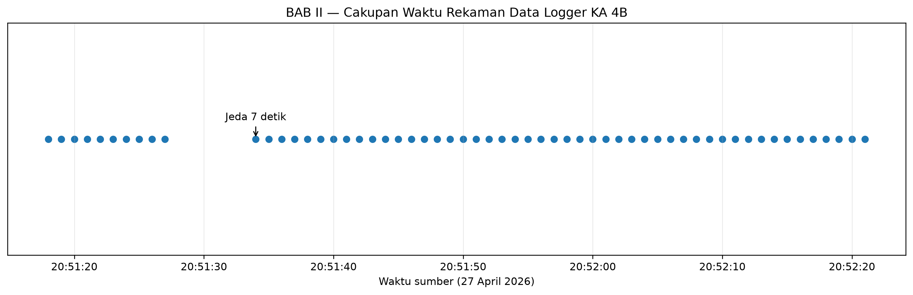

Gambar memperlihatkan timestamp yang benar-benar tercantum. Jeda enam detik antara 20:51:27 dan 20:51:34 dipertahankan sebagai kekosongan sumber, bukan diisi dengan interpolasi.

Sumber: hasil olah penulis dari transkripsi Tabel 6–10.

### Visual tambahan: asal-usul data, pertanyaan analitis, dan skema

**Gambar 2.2. Pipeline akuisisi dan penyiapan data**

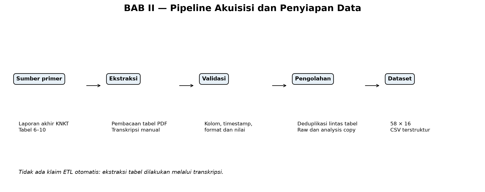

Tujuan diagram adalah mendokumentasikan alur dari laporan akhir KNKT, pembacaan tabel PDF dan transkripsi manual, validasi, deduplikasi, hingga pembentukan CSV analitis. Cara membaca: ikuti urutan proses dari sumber primer ke dataset. Diagram mendukung provenance bahwa data diperoleh melalui transkripsi, bukan ekspor otomatis perangkat. Batasnya, pipeline tidak membuktikan ketepatan setiap sel; pemeriksaan silang terhadap tabel sumber tetap diperlukan.

**Gambar 2.3. Matriks data terhadap pertanyaan analitis**

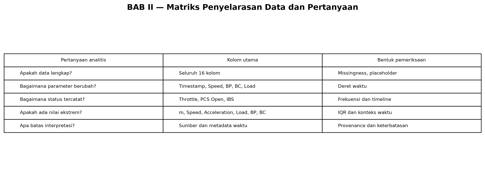

Tujuan matriks adalah memperlihatkan hubungan pertanyaan EDA, kolom yang relevan, dan teknik pemeriksaan. Cara membaca: setiap baris memasangkan pertanyaan dengan variabel dan metode yang sesuai. Visual mendukung bahwa pemilihan teknik mengikuti pertanyaan, misalnya missingness untuk kualitas data dan deret waktu untuk perubahan parameter. Batasnya, matriks merupakan rancangan analisis, bukan hasil yang membuktikan hipotesis investigasi.

**Gambar 2.4. Ringkasan skema dataset**

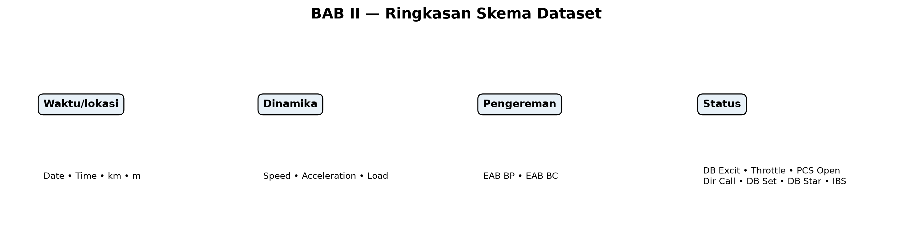

Tujuan gambar adalah mengelompokkan 16 kolom menurut dimensi waktu/lokasi, dinamika, pengereman, dan status. Cara membaca: kelompok menunjukkan fungsi analitis umum kolom, bukan klasifikasi resmi perangkat. Visual mendukung penelusuran skema dan pemilihan variabel pada bab berikutnya. Batasnya, pengelompokan tidak menambahkan variabel baru dan tidak menyatakan hubungan kausal antarparameter.

## 2.5 Penyelarasan dengan Kebutuhan Operasional

Data relevan untuk memahami perubahan parameter lokomotif pada cuplikan waktu yang meliputi fase sebelum emergency brake, pengereman darurat, dan saat tabrakan. Dataset gabungan memuat 58 rekaman unik dari Tabel 6–10. Meskipun lebih luas daripada Tabel 9–10 saja, data ini tetap belum cukup untuk menggambarkan keseluruhan rangkaian peristiwa, seluruh sistem pengereman rangkaian, kondisi sarana lain, aspek persinyalan secara lengkap, atau faktor eksternal.

Kebutuhan data tambahan untuk analisis yang lebih luas mencakup Tabel 6–8, keterangan teknis sistem pengereman, kronologi persinyalan dan komunikasi operasional, serta data pendukung lain yang telah diverifikasi dari laporan KNKT. Penambahan data harus menjaga identitas sumber, satuan, urutan waktu, dan jejak transkripsi.

## 2.6 Kerangka Bukti Investigasi dan Kebutuhan Data Lintas-Disiplin

Agar analisis tidak melampaui bukti yang tersedia, setiap kelompok pertanyaan investigasi dipetakan terhadap sumber data yang diperlukan. Status *tersedia* berarti tercakup dalam dataset yang dianalisis; *konteks dokumen* berarti dapat ditelaah dari bagian lain laporan KNKT tetapi belum menjadi variabel dalam dataset; dan *belum tersedia dalam dataset* berarti tidak boleh disimpulkan dari Data Logger KA 4B saja.

| Domain investigasi | Pertanyaan analitis | Bukti/data yang diperlukan | Status dalam proyek ini |
|---|---|---|---|
| Data logger lokomotif | Bagaimana kecepatan, arus, throttle, BP, BC, dan IBS berubah terhadap waktu? | Tabel 6–10 Data Logger KA 4B | Tersedia sebagai transkripsi tabel |
| Rekonstruksi kronologi | Bagaimana urutan kejadian lintas sumber dan ketidakpastian waktunya? | Timestamp logger, kronologi KNKT, jam sistem, catatan sinkronisasi | Terbatas; satu sumber logger dan narasi dokumen |
| Persinyalan, block, interlocking, wesel | Apa aspek status sinyal, rute, okupansi petak, dan penguncian wesel? | Log interlocking, log block, indikasi sinyal, data CTC/PPKA, diagram rute | Belum tersedia sebagai dataset terstruktur |
| ATP/ETCS/CBTC dan perlindungan SPAD | Apakah sistem proteksi aktif, memberi peringatan, atau melakukan intervensi? | Log perangkat proteksi yang benar-benar terpasang, konfigurasi, alarm, event record | Belum tersedia; jangan mengasumsikan teknologi tertentu terpasang |
| Sinkronisasi dua kereta | Bagaimana posisi, kecepatan, dan waktu kedua rangkaian dibandingkan? | Data logger KA 5568A dan KA 4B, sumber waktu, metode clock correction | Belum tersedia untuk analisis sinkronisasi |
| Komunikasi dan dispatch | Apa instruksi, konfirmasi, dan urutan komunikasi operasional? | Rekaman radio/audio, log telepon, catatan PPKA/OC, timestamp dan identitas kanal | Belum tersedia dalam dataset |
| Dinamika pengereman | Berapa jarak henti dan perlambatan aktual serta bagaimana perbandingannya dengan karakteristik rem? | Kecepatan awal, waktu respons, tekanan rem, massa, gradien, kondisi roda-rel, komposisi rangkaian, parameter rem | Belum cukup untuk menghitung jarak henti secara tervalidasi |
| Faktor manusia | Apa kondisi kewaspadaan, beban kerja, kepatuhan prosedur, dan tindakan kru? | Wawancara, rekaman komunikasi, jadwal dinas, bukti prosedural, data relevan lain | Tidak dapat dinilai dari logger saja |
| Prasarana dan jarak pandang | Bagaimana geometri lintas, lokasi sinyal, jarak pandang, cuaca, dan pencahayaan? | Track chart, survei geospasial, foto/video, cuaca, kondisi penerangan | Belum dianalisis dari dataset ini |
| Crashworthiness | Bagaimana pola deformasi, penetrasi, dan transfer energi benturan? | Pemeriksaan fisik, foto ukur, data struktur sarana, material, titik kontak | Di luar cakupan dataset logger |
| Operasi perjalanan | Bagaimana posisi kejadian terhadap GAPEKA, perjalanan aktual, dan izin masuk petak? | GAPEKA, train graph aktual, log perjalanan, izin dan komunikasi operasi | Perlu dokumen operasional pendukung |

Matriks tersebut adalah peta kebutuhan bukti, bukan pernyataan bahwa seluruh bukti telah diperoleh atau telah dianalisis. Istilah ATP, ETCS, CBTC, deadman, anti-climber, dan perangkat sejenis hanya boleh digunakan sebagai kategori pemeriksaan apabila relevan dengan konfigurasi sarana/prasarana yang dibuktikan oleh dokumen teknis. Tidak boleh diasumsikan terpasang hanya karena istilah tersebut termasuk dalam kerangka keahlian tim.

---

# BAB III. MEMUAT DAN MEMERIKSA DATA (IMPORTING AND INSPECTING THE DATA)

## 3.1 Import Library dan Loading Dataset

Library utama adalah Pandas untuk pemuatan dan manipulasi tabel, NumPy untuk operasi numerik, serta Matplotlib/Seaborn untuk visualisasi. Contoh pemuatan dataset kanonis dari repository (CSV):

```python
import pandas as pd
import numpy as np

file_path = "data/processed/data_logger_knkt_tabel_6_10.csv"
df = pd.read_csv(file_path)
```

Jika menggunakan CSV:

```python
df = pd.read_csv("data/processed/data_logger_knkt_tabel_6_10.csv")
```

Dataset tidak dibagi menjadi data latih dan data uji karena proyek ini belum melakukan pemodelan prediktif.

## 3.2 Inspeksi Dimensi dan Struktur Data

Pemeriksaan dilakukan menggunakan:

```python
df.head()
df.shape
df.columns.tolist()
```

Hasil pemeriksaan: `df.shape == (58, 16)`. Gunakan `pd.read_csv("data/processed/data_logger_knkt_tabel_6_10.csv")` untuk memuat versi CSV dalam repositori. Nama kolom mengikuti urutan skema 16 kolom yang disebutkan pada Bab 2. Dataset memuat 58 rekaman unik hasil penggabungan Tabel 6–10.

## 3.3 Pemeriksaan Tipe Data dan Informasi Umum

Hasil pembacaan dataset gabungan: `km`, `m`, `Speed (km/h)`, `Load (amps)`, `EAB BP (psi)`, dan `EAB BC (psi)` terbaca integer. `Acceleration (m/sec²)` terbaca object karena memuat angka dan placeholder `---`. `Date`, `Time`, serta variabel status terbaca object. Empat kolom `DB Excit`, `Dir Call`, `DB Set`, dan `DB Star` bertipe object dan memiliki 26 nilai kosong pada baris Tabel 9–10, tetapi berisi data pada 32 baris Tabel 6–8.

Tipe object pada akselerasi dapat dimengerti karena kolom memuat angka dan teks `---`. Tipe tanggal dan waktu belum berupa datetime; parsing dilakukan secara eksplisit pada salinan analisis.

**Gambar 3.1. Kelengkapan kolom dataset**

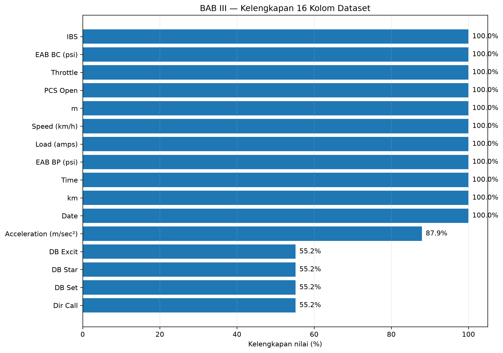

Kelengkapan dihitung dengan memperlakukan sel kosong dan placeholder sebagai nilai yang tidak tersedia. Empat kolom status tidak ditampilkan pada Tabel 9–10, sedangkan akselerasi memiliki tujuh placeholder.

Sumber: hasil olah penulis dari dataset transkripsi.

### Visual tambahan: struktur, isi, tipe, dan rentang data

**Gambar 3.2. Scorecard struktur dataset**

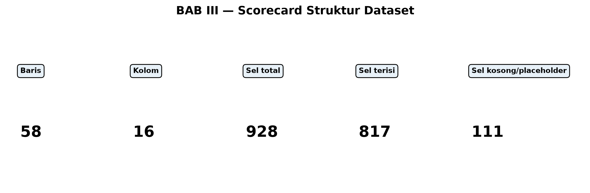

Tujuan gambar ini adalah merangkum ukuran tabel dan komposisi sel. Cara membacanya: baris dan kolom menunjukkan dimensi dataset, sedangkan sel terisi dan sel kosong/placeholder merupakan hitungan sel, bukan jumlah observasi independen. Visual mendukung pemeriksaan bahwa CSV analitis berisi 58 × 16. Batas interpretasinya, agregat ini tidak menjelaskan lokasi setiap nilai kosong; pola rinci dibahas pada Bab IV.

**Gambar 3.3. Cuplikan data mentah**

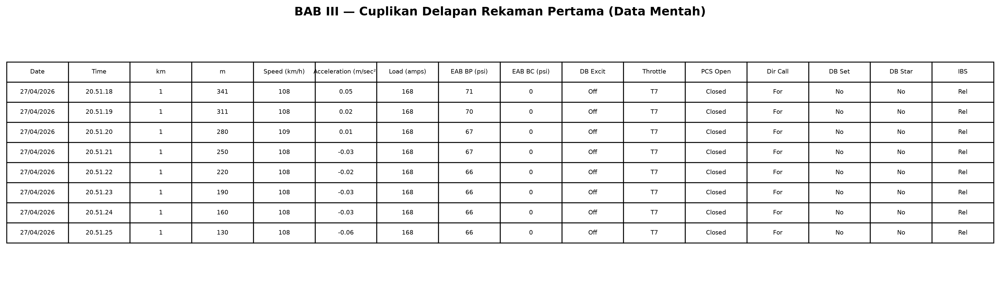

Tujuannya memperlihatkan contoh representasi transkripsi sebelum konversi tipe. Pembaca menelusuri kolom dan nilai per baris, termasuk format waktu dan penanda sumber. Gambar mendukung bahwa nilai dipertahankan sebagai teks pada tahap pembacaan raw. Cuplikan delapan baris bukan bukti bahwa seluruh 58 baris bebas kesalahan; validasi penuh tetap memerlukan pemeriksaan skema dan perbandingan dengan PDF.

**Gambar 3.4. Distribusi tipe data pada salinan analisis**

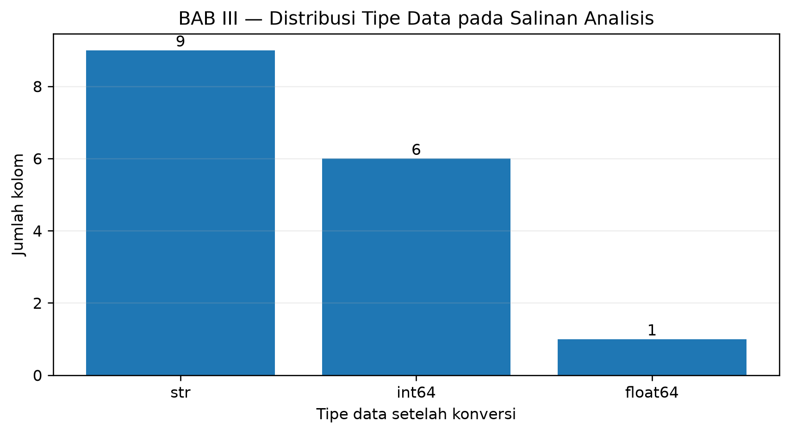

Tujuan gambar adalah menunjukkan kelompok tipe setelah konversi pada salinan analisis. Cara membaca: tinggi batang menunjukkan jumlah kolom pada setiap tipe. Gambar mendukung pembedaan variabel numerik, waktu, dan kategori. Batasnya, ringkasan tipe tidak memperlihatkan aturan konversi per kolom; pemetaan rinci diberikan pada Bab VI.

**Gambar 3.5. Rentang minimum dan maksimum variabel numerik**

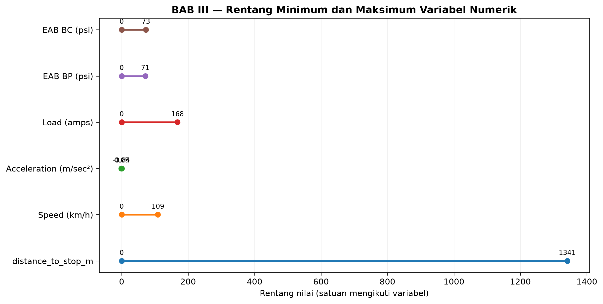

Tujuan visual adalah memeriksa batas nilai yang benar-benar tercatat. Setiap garis menghubungkan minimum dan maksimum satu variabel; satuan mengikuti nama variabel dan tidak dapat dibandingkan lintas variabel sebagai besaran sejenis. Visual mendukung rentang kecepatan 0–109 km/jam serta rentang numerik lain yang digunakan pada analisis. Batasnya, rentang bukan distribusi, bukan batas aman operasional, dan bukan penilaian kondisi teknis.

## 3.4 Penanganan Waktu dan Integritas Urutan Rekaman

Kolom `Date` dan `Time` perlu digabung menjadi timestamp pada salinan analisis dengan format yang eksplisit. Pemeriksaan urutan dilakukan setelah parsing, tetapi timestamp hasil parsing tetap merepresentasikan waktu sebagaimana dicetak pada tabel sumber. KNKT menetapkan CCTV KA 5568A sebagai master time dan menyesuaikan timestamp logger lokomotif sebesar +2 detik pada event tabrakan. EDA ini tidak melakukan sinkronisasi ulang atau menguji offset/drift seluruh sumber; timestamp dataset tidak boleh dianggap sebagai hasil kalibrasi independen terhadap seluruh logger, radio, interlocking, atau CCTV. Setiap analisis lintas-sumber nantinya harus mendokumentasikan zona waktu, resolusi timestamp, kemungkinan offset/drift, metode koreksi jam, dan rentang ketidakpastian. Jangan menggeser timestamp agar tampak cocok dengan kronologi tanpa dasar kalibrasi atau bukti sinkronisasi.

## 3.5 Ringkasan Statistik Awal

Ringkasan statistik untuk variabel numerik yang memiliki data:
| Variabel | n | Mean | Median | Modus | Std. deviasi | Varians | Q1 | Q3 | Minimum | Maksimum |
|---|---:|---:|---:|---:|---:|---:|---:|---:|---:|---:|
| distance_to_stop_m | 58 | 472,897 | 378,5 | 0 | 421,531 | 177.688,059 | 100 | 741 | 0 | 1.341 |
| Speed (km/h) | 58 | 73,638 | 82,5 | 108 | 33,077 | 1.094,060 | 57,5 | 101,75 | 0 | 109 |
| Acceleration (m/sec²) | 51 | -0,336 | -0,38 | -0,38 | 0,203 | 0,041 | -0,5 | -0,16 | -0,84 | 0,05 |
| Load (amps) | 58 | 86,207 | 136 | 0 | 76,587 | 5.865,641 | 0 | 152 | 0 | 168 |
| EAB BP (psi) | 58 | 31,897 | 49 | 0 | 28,264 | 798,831 | 0 | 51,75 | 0 | 71 |
| EAB BC (psi) | 58 | 26 | 2 | 0 | 31,191 | 972,877 | 0 | 58 | 0 | 73 |

Untuk akselerasi, n numerik adalah 51 karena tujuh nilai `---` tidak dapat diperlakukan sebagai angka. Statistik dihitung setelah placeholder dikecualikan pada salinan analisis. Empat kolom status merupakan variabel kategorikal, sehingga tidak diringkas dengan statistik numerik.

---

# BAB IV. PENILAIAN DAN PENANGANAN KUALITAS DATA (DATA QUALITY ASSESSMENT)

## 4.1 Identifikasi Missing Values

Pemeriksaan `isnull().sum()` menemukan 26 nilai kosong pada masing-masing kolom `DB Excit`, `Dir Call`, `DB Set`, dan `DB Star`, atau 44,83% dari 58 baris per kolom. Keempat kolom tersebut tidak ditampilkan pada Tabel 9–10. Secara terpisah, `Acceleration (m/sec²)` memiliki tujuh placeholder `---` (12,07% dari 58 baris) pada bagian Tabel 10. Placeholder ini bukan null teknis dalam berkas transkripsi mentah, tetapi menandakan data akselerasi tidak tersedia/tidak terbaca sebagaimana ditampilkan pada sumber.

**Gambar 4.1. Nilai tidak tersedia per kolom**

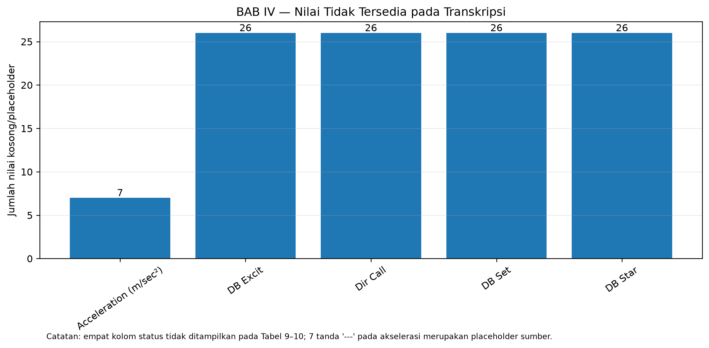

Grafik membedakan jumlah sel kosong dan placeholder pada transkripsi. Nilai tersebut tidak diimputasi dan tidak diubah menjadi nol.

Sumber: hasil olah penulis dari dataset transkripsi.

## 4.2 Analisis Penyebab Missing Values

Mekanisme kehilangan data tidak dapat diklasifikasikan secara menyeluruh sebagai MCAR, MAR, atau MNAR hanya dari dataset kecil ini.

- Empat kolom kosong karena tidak ditampilkan pada Tabel 9–10. Kondisi ini lebih tepat disebut tidak tersedia dalam cakupan sumber, bukan missing value observasional yang mekanismenya dapat diuji.
- Tujuh placeholder akselerasi terkait dengan kondisi tabrakan dan keterbatasan pembacaan sensor sebagaimana diterangkan dalam laporan KNKT. Karena berkaitan dengan peristiwa yang sedang diamati, kehilangan tersebut tidak layak diasumsikan MCAR. Akan tetapi, label MAR/MNAR formal tidak ditetapkan tanpa data sensor dan rancangan pengukuran yang lebih lengkap.

## 4.3 Pemeriksaan Duplikasi dan Kebijakan Deduplicasi

Pemeriksaan dilakukan pada dua tingkat karena terdapat perbedaan antara baris sumber dan rekaman unik. Lima tabel menghasilkan 59 baris transkripsi. Satu baris pada pukul 20:51:43 tercantum identik pada Tabel 7 dan Tabel 8. Untuk analisis gabungan, satu kemunculan duplikat identik tersebut dihitung satu kali sehingga dataset analitis berisi 58 rekaman unik. Keputusan ini tidak menghapus bukti asal: sheet `Data_By_Source` tetap menyimpan 59 baris beserta identitas tabel sumber, sedangkan `Data_Logger_Raw`/CSV analitis memuat 58 rekaman setelah deduplikasi. Dengan demikian, duplikasi lintas tabel tidak disamakan dengan dua kejadian logger yang berbeda.

Tidak ditemukan duplikasi baris identik pada dataset analitis 58 × 16 setelah proses tersebut. Deduplikasi hanya dilakukan terhadap baris yang seluruh nilai dan timestamp-nya identik; baris dengan timestamp sama tetapi nilai berbeda tidak boleh dihapus otomatis dan harus ditinjau terhadap PDF sumber.

## 4.4 Pemeriksaan Konsistensi dan Kebijakan Penanganan

Pemeriksaan konsistensi meliputi kesesuaian jumlah kolom (16), format tanggal dan waktu, nilai numerik, kategori status, placeholder, serta urutan timestamp. Tanggal ditulis `27/04/2026` dan waktu mengikuti format `HH.MM.SS`; parsing dilakukan pada salinan analisis menggunakan format eksplisit `%d/%m/%Y %H.%M.%S`. Tujuh placeholder `---` pada akselerasi dipertahankan sebagai teks pada data mentah dan dikonversi menjadi missing hanya pada seri numerik analisis. Empat kolom status dengan 26 nilai kosong tetap dipertahankan karena tidak tersedia pada Tabel 9–10.

Tidak dilakukan imputasi mean, median, modus, KNN Imputer, atau MICE. Pengisian nilai sensor yang tidak terbaca dengan angka statistik akan menghasilkan nilai buatan yang tidak bersumber dari logger. Tidak dilakukan interpolasi pada celah waktu 20:51:28–20:51:33. Tidak dilakukan penghapusan baris/kolom, scaling, encoding, atau winsorization pada dataset mentah. Setiap koreksi transkripsi harus disertai bukti pembanding dari tabel PDF dan dicatat sebagai perubahan yang dapat ditelusuri.

---

### Visual tambahan: pola missingness dan konsekuensi deduplikasi

**Gambar 4.2. Missingness Matrix pada tingkat rekaman dan kolom**

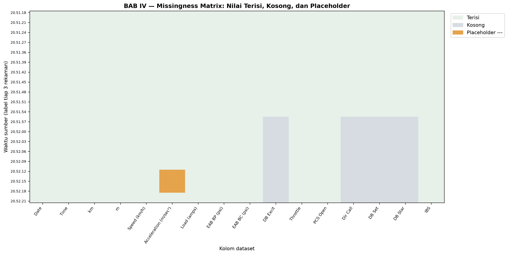

Tujuan matriks adalah memperlihatkan lokasi sel terisi, sel kosong, dan placeholder --- pada seluruh 58 rekaman dan 16 kolom. Cara membaca: sumbu horizontal adalah kolom, sumbu vertikal adalah urutan rekaman; warna membedakan tiga keadaan tersebut. Matriks memperlihatkan bahwa kekosongan empat kolom status berkelompok pada bagian data yang bersumber dari Tabel 9–10, sedangkan tujuh placeholder akselerasi merupakan penanda terpisah. Batas interpretasi: pola visual tidak mengidentifikasi mekanisme probabilistik missingness dan tidak membuktikan kerusakan sensor.

**Gambar 4.3. Ketidaktersediaan empat kolom status**

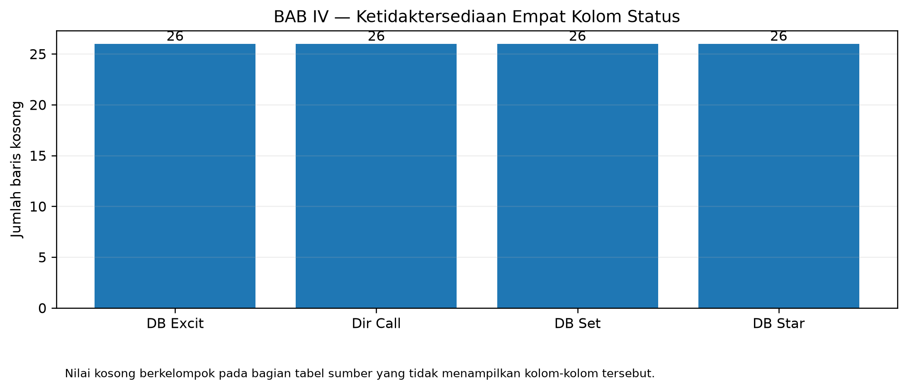

Tujuannya menguji apakah kekosongan kolom status tersebar acak atau mengikuti cakupan tabel. Cara membaca: setiap batang menunjukkan 26 sel kosong pada satu kolom. Hasil mendukung penjelasan bahwa DB Excit, Dir Call, DB Set, dan DB Star tidak ditampilkan pada Tabel 9–10. Batasnya, grafik tidak membuktikan status perangkat pada interval tersebut; tidak ada status yang boleh direkonstruksi dari kekosongan.

**Gambar 4.4. Dampak deduplikasi pada jumlah baris**

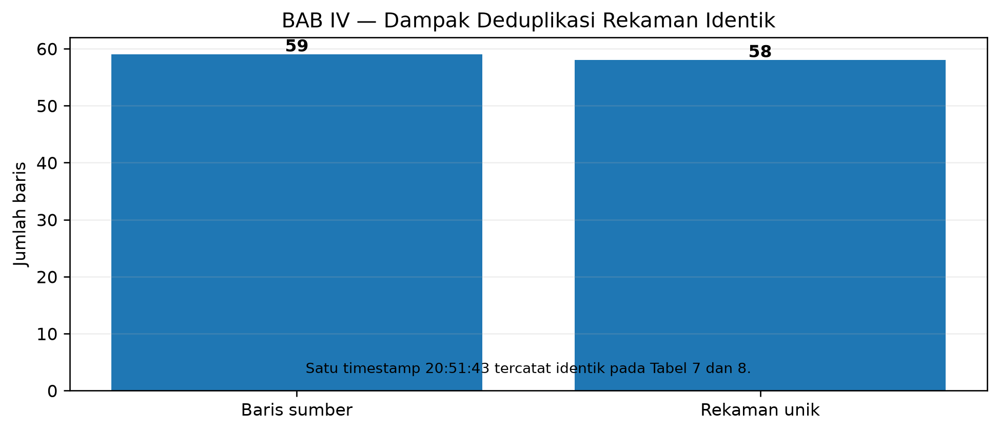

Tujuan gambar adalah menjelaskan perubahan 59 baris transkripsi menjadi 58 rekaman unik. Cara membaca: bandingkan jumlah baris sumber dan jumlah rekaman setelah satu duplikasi identik pukul 20:51:43 lintas Tabel 7 dan 8 dihitung satu kali. Gambar mendukung keputusan deduplikasi untuk analisis gabungan, sementara provenance 59 baris tetap dipertahankan pada data per sumber. Batasnya, visual ini tidak menggambarkan penghapusan missing value atau koreksi isi data.

### Keputusan metodologis atas missingness

Tiga keadaan tidak boleh dicampuradukkan. Pertama, sel kosong pada empat kolom status adalah missingness struktural/cakupan sumber: kolom tidak disajikan pada Tabel 9–10. Kedua, --- pada akselerasi adalah placeholder eksplisit dari sumber, bukan sel kosong pada transkripsi mentah; placeholder hanya dikecualikan dari kalkulasi numerik salinan analisis. Ketiga, sel numerik yang benar-benar kosong harus ditelusuri sesuai konteks sumbernya, bukan otomatis dianggap setara dengan dua keadaan sebelumnya.

Berdasarkan data ini, mekanisme MCAR, MAR, maupun MNAR tidak dapat ditetapkan secara sahih. Pengelompokan missingness pada bagian tabel tertentu memberi informasi provenance, tetapi bukan pengujian mekanisme statistik. Tidak dilakukan imputasi karena tidak tersedia dasar untuk merekonstruksi nilai sensor atau status yang tidak disajikan. Mengisi nilai dengan mean/median, interpolasi, atau kategori tebakan akan menambahkan informasi yang tidak berasal dari bukti sumber. Dengan demikian, semua nilai tidak tersedia dipertahankan sebagai keterbatasan analisis.

# BAB V. EKSPLORASI KARAKTERISTIK DATA (EXPLORING DATA CHARACTERISTICS)

## 5.1 Statistik Deskriptif Variabel Numerik

Tabel pada Bab 3 menyajikan mean, median, modus, standar deviasi, minimum, dan maksimum. Secara umum, distribusi nilai pada beberapa variabel dipengaruhi oleh perubahan keadaan operasi dalam rentang waktu singkat. Karena data merupakan runtun waktu dengan interval yang umumnya satu detik tetapi memiliki celah enam detik, nilai tidak dapat diperlakukan sebagai sampel acak yang saling independen.

Kolom `km` dan `m` bukan dua variabel analitis independen. Keduanya digabung menjadi `distance_to_stop_m`, yaitu jarak tersisa menuju titik henti akhir. Kolom sumber dipertahankan untuk keterlacakan. Nilai gabungan bukan chainage absolut; ketidaksesuaian narasi chainage KNKT dicatat dalam dokumen verifikasi sumber.

## 5.2 Bentuk Distribusi Variabel Numerik

Nilai skewness dan excess kurtosis pada variabel numerik yang dapat dihitung:
| Variabel | Skewness | Excess kurtosis |
|---|---:|---:|
| distance_to_stop_m | 0,658 | -0,767 |
| Speed (km/h) | -0,958 | -0,084 |
| Acceleration (m/sec²) | 0,290 | -0,444 |
| Load (amps) | -0,218 | -1,938 |
| EAB BP (psi) | -0,130 | -1,830 |
| EAB BC (psi) | 0,503 | -1,660 |

Kurtosis yang disajikan adalah excess kurtosis (kurtosis Fisher), sehingga nilai 0 menjadi acuan distribusi normal secara teoretis. Pada gabungan ini, skewness kecepatan negatif (-0,958), sedangkan skewness akselerasi mendekati nol (0,290). Nilai skewness tidak digunakan untuk menyimpulkan normalitas. Akselerasi dihitung hanya dari 51 angka, bukan tujuh placeholder.

Ukuran skewness dan kurtosis pada sampel kecil dan berurutan ini tidak cukup untuk menyatakan normalitas. Histogram/KDE dapat membantu inspeksi visual, tetapi uji normalitas formal dan asumsi inferensial tidak menjadi tujuan utama proyek.

**Gambar 5.1. Distribusi variabel numerik**

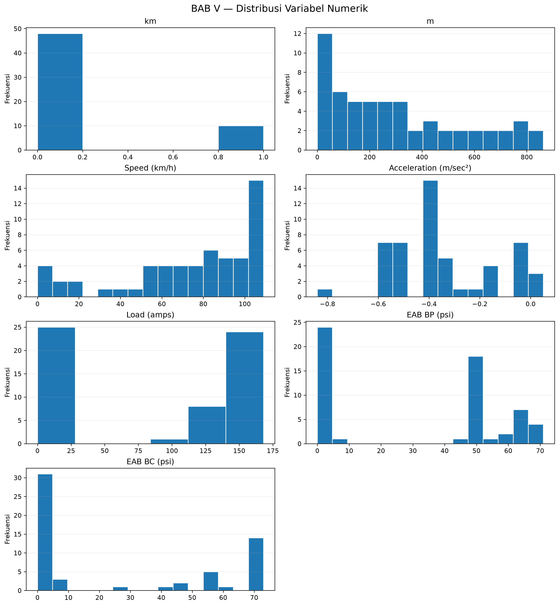

**Gambar 5.2. Frekuensi variabel kategorikal**

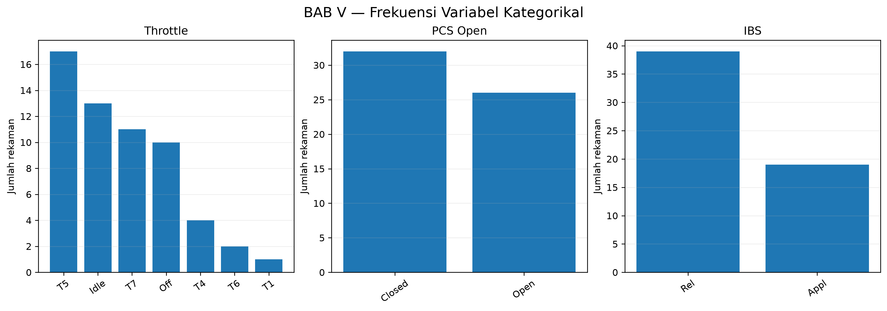

Histogram menunjukkan distribusi nilai yang tercatat, bukan distribusi probabilitas populasi. Diagram kategori menggunakan jumlah rekaman; karena interval dan ketersediaan status tidak seragam, jumlah kategori tidak langsung ditafsirkan sebagai durasi.

Sumber: hasil olah penulis dari dataset transkripsi.

## 5.3 Ringkasan Frekuensi Variabel Kategorikal

Frekuensi kategori pada seluruh 58 rekaman adalah sebagai berikut: `Throttle` terdiri atas T5 (17), Idle (13), T7 (11), Off (10), T4 (4), T6 (2), dan T1 (1). `PCS Open` tercatat Closed sebanyak 32 dan Open sebanyak 26. `IBS` tercatat Rel sebanyak 39 dan Appl sebanyak 19. Frekuensi ini merangkum kategori yang tertulis pada tabel sumber; frekuensi tidak menjelaskan durasi keadaan secara langsung karena interval antarrekaman tidak seluruhnya lengkap dan tidak semua status tersedia pada setiap fase.

---

### Visual tambahan: bentuk distribusi numerik

**Gambar 5.3. Box plot mean dan median**

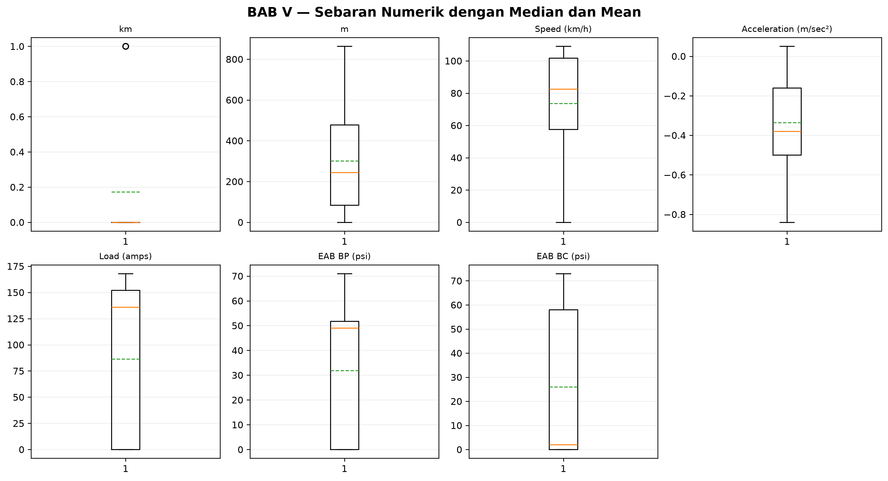

Tujuan gambar adalah membandingkan median, rentang antarkuartil, whisker, dan mean pada variabel numerik. Cara membaca: garis di dalam kotak menunjukkan median, penanda mean menunjukkan rata-rata, dan kotak menunjukkan rentang kuartil. Visual mendukung pemeriksaan perbedaan pusat dan sebaran. Batasnya, box plot tidak mempertahankan urutan waktu dan tidak boleh digunakan sendirian untuk menyimpulkan fase operasi.

**Gambar 5.4. Empirical Cumulative Distribution Function (ECDF)**

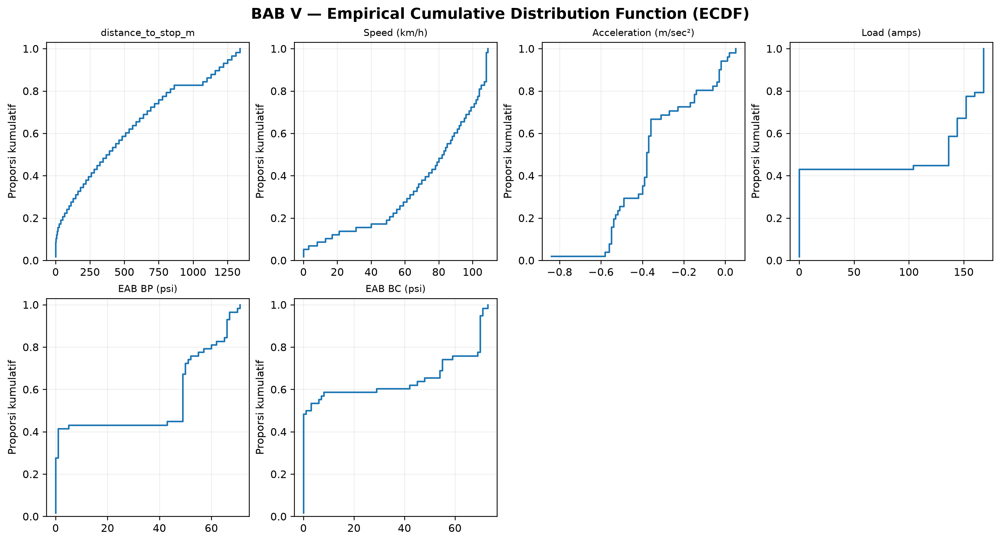

Tujuan ECDF adalah memperlihatkan proporsi kumulatif observasi pada atau di bawah nilai tertentu tanpa pemilihan bin. Cara membaca: pada suatu nilai sumbu X, sumbu Y menunjukkan proporsi data yang nilainya tidak melebihi nilai tersebut. Visual mendukung pembacaan kuantil dan perbandingan distribusi empiris. Batasnya, ukuran sampel kecil dan urutan temporal membuat ECDF bersifat deskriptif untuk cuplikan kejadian ini, bukan estimasi distribusi populasi.

**Gambar 5.5. Skewness dan excess kurtosis**

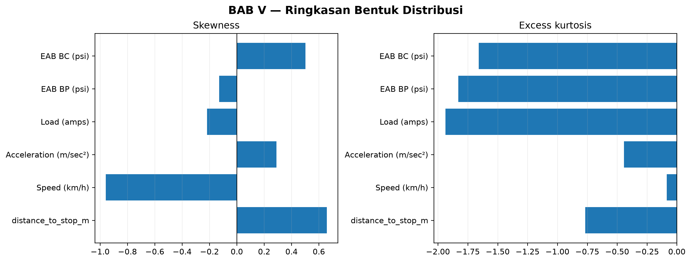

Tujuannya merangkum kemiringan dan excess kurtosis variabel numerik. Cara membaca: nol menjadi garis acuan simetri untuk skewness dan acuan excess kurtosis Fisher. Gambar mendukung angka pada tabel momen distribusi, termasuk skewness kecepatan negatif dan akselerasi yang dihitung dari 51 nilai numerik. Batasnya, statistik momen pada sampel kecil tidak membuktikan normalitas atau perilaku populasi.

# BAB VI. TRANSFORMASI DAN REKAYASA FITUR (DATA TRANSFORMATION AND FEATURE ENGINEERING)

## 6.1 Prinsip Transformasi Data

Tidak diterapkan transformasi log, akar kuadrat, Box-Cox, atau Yeo-Johnson pada dataset sumber. Beberapa variabel menunjukkan kemiringan distribusi, tetapi transformasi tidak diperlukan untuk tujuan deskriptif dan dapat mengurangi keterbacaan satuan operasional. Perlu diluruskan bahwa model linear tidak mensyaratkan setiap fitur harus berdistribusi normal; asumsi normalitas dalam regresi klasik terutama berkaitan dengan residual untuk keperluan inferensi. Jika pemodelan dilakukan pada tahap berikutnya, transformasi hanya dipertimbangkan berdasarkan kebutuhan model, bentuk hubungan, dan diagnostik residual, kemudian diuji pada salinan data.

## 6.2 Konversi dan Validasi Tipe Data

Konversi tipe data dilakukan hanya pada salinan analisis. Kolom `Date` dan `Time` digabung dan diparsing menjadi `datetime` dengan format eksplisit `%d/%m/%Y %H.%M.%S`. Kolom sumber `km` dan `m` dikonversi pada salinan analisis, kemudian digabung menjadi `distance_to_stop_m`; hanya besaran gabungan yang digunakan sebagai variabel jarak analitis. Variabel numerik lain yang dikonversi adalah `Speed (km/h)`, `Load (amps)`, `EAB BP (psi)`, dan `EAB BC (psi)`. Pada `Acceleration (m/sec²)`, penanda `---` terlebih dahulu dipetakan menjadi missing pada salinan analisis, kemudian nilai lainnya dikonversi menjadi numerik. Kolom `Throttle`, `PCS Open`, `IBS`, `DB Excit`, `Dir Call`, `DB Set`, dan `DB Star` dipertahankan sebagai kategori/teks.

Hasil konversi divalidasi dengan membandingkan jumlah baris sebelum dan sesudah konversi, jumlah placeholder yang berubah menjadi missing, jumlah missing struktural, serta rentang nilai sebelum dan sesudah. Konversi tidak boleh mengubah jumlah 58 rekaman atau mengisi nilai yang tidak tersedia.

## 6.3 Rekayasa Fitur Temporal

Dari timestamp gabungan dibuat fitur `elapsed_seconds`, yaitu selisih detik terhadap timestamp paling awal. Fitur ini berguna untuk sumbu waktu numerik dan pengukuran jarak waktu antarrekaman. Karena terdapat gap 20:51:28–20:51:33, selisih waktu aktual dipertahankan; indeks baris tidak boleh dianggap sebagai detik yang selalu berjarak satu detik. Timestamp sumber tidak digeser dan tidak dinyatakan tersinkronisasi dengan sumber lain.

**Gambar 6.1. Interval aktual antarrekaman**

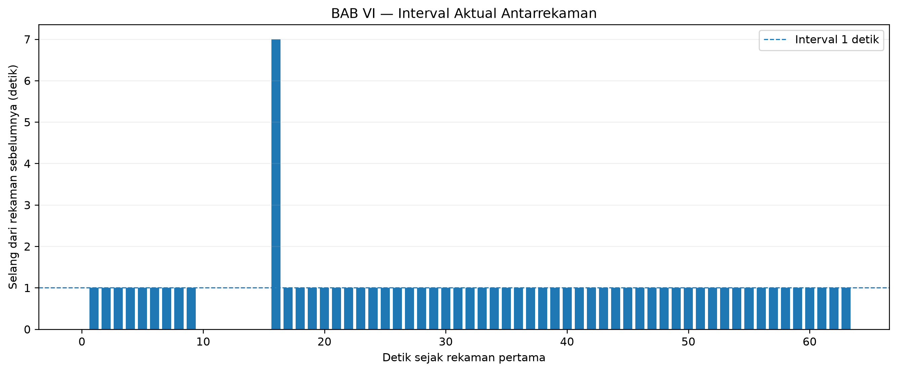

Sumbu waktu turunan menggunakan selisih timestamp aktual. Interval enam detik tampak sebagai gap dan tidak dipadatkan menjadi interval satu detik.

Sumber: hasil olah penulis dari timestamp pada transkripsi.

## 6.4 Rekayasa Fitur Operasional dan Batas Transformasi

Penanda fase operasi dapat ditambahkan hanya jika batas fase diambil secara eksplisit dari judul tabel atau uraian KNKT, bukan dibentuk dari tebakan terhadap pola grafik. Pada tahap EDA ini tidak dibuat label target prediksi. Tidak diterapkan transformasi log, akar kuadrat, Box-Cox, Yeo-Johnson, StandardScaler, MinMaxScaler, one-hot encoding, atau ordinal encoding karena belum ada kebutuhan analisis yang membenarkannya. Nilai dan satuan asli dipertahankan. Jika transformasi diperlukan pada penelitian berikutnya, hasil transformasi harus berada pada fitur turunan terpisah dan parameter transformasi harus dipelajari dari data latih saja.

---

### Visual tambahan: dokumentasi transformasi aktual

**Gambar 6.2. Alur transformasi aktual**

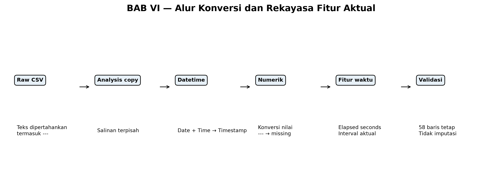

Tujuannya menunjukkan urutan pengolahan yang benar-benar diterapkan: raw CSV dipertahankan, salinan analisis dibuat, timestamp diparsing, kolom numerik dikonversi, fitur waktu dihitung, lalu jumlah baris divalidasi. Cara membaca: ikuti alur dari kiri ke kanan. Gambar mendukung bahwa transformasi dilakukan pada salinan, bukan menimpa data mentah, serta tidak mencakup imputasi. Batasnya, diagram merupakan ringkasan proses; detail teknis tetap berada pada kode dan notebook.

**Gambar 6.3. Pemetaan tipe data dan konversi**

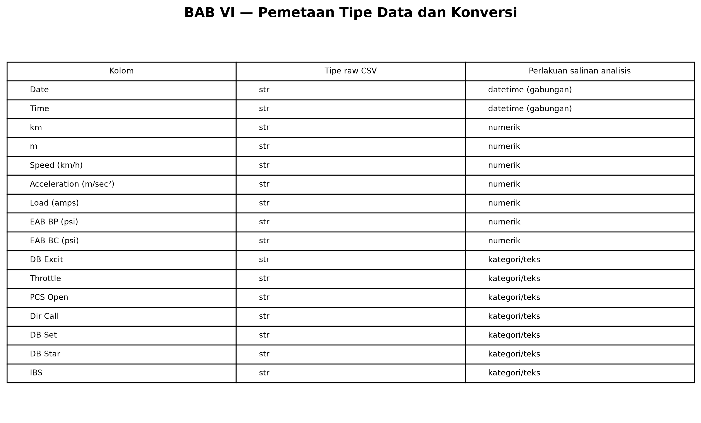

Tujuan gambar adalah memperlihatkan perlakuan setiap kolom dari pembacaan raw ke salinan analisis. Cara membaca: bandingkan tipe raw dengan tipe/kelompok tujuan. Gambar mendukung kebijakan bahwa tanggal dan waktu digabung menjadi timestamp, variabel terukur dikonversi numerik, dan status dipertahankan sebagai kategori/teks. Batasnya, tabel pemetaan tidak menggantikan validasi nilai, unit, maupun jumlah observasi valid setelah konversi.

# BAB VII. VISUALISASI DAN ANALISIS HUBUNGAN ANTARVARIABEL (DATA VISUALIZATION AND RELATIONSHIP ANALYSIS)

## 7.1 Analisis Univariat (Univariate Analysis)

Analisis univariat dilakukan dengan histogram/box plot untuk variabel numerik dan diagram batang untuk kategori. Variabel yang paling relevan adalah jarak tersisa menuju titik henti akhir (`distance_to_stop_m`), kecepatan, arus motor traksi, tekanan BP, tekanan BC, dan akselerasi numerik. Frekuensi throttle pada 58 baris: T5 17, Idle 13, T7 11, Off 10, T4 4, T6 2, dan T1 1. PCS tercatat Closed pada 32 baris dan Open pada 26 baris. IBS tercatat Rel pada 39 baris dan Appl pada 19 baris. Frekuensi tersebut menggambarkan keseluruhan gabungan Tabel 6–10, bukan hanya Tabel 9–10.

## 7.2 Analisis Bivariat dan Multivariat (Bivariate and Multivariate Analysis)

Grafik garis kecepatan terhadap waktu dan grafik tekanan BP/BC terhadap waktu lebih sesuai daripada scatter plot generik karena urutan waktu merupakan konteks utama data. Perbandingan dua tekanan harus memperhatikan satuan yang sama (psi), sedangkan arus motor traksi menggunakan ampere dan kecepatan menggunakan km/jam. Hubungan visual tidak otomatis menunjukkan pengaruh kausal. Untuk rekonstruksi kecelakaan, sumbu waktu harus diperlakukan sebagai kunci pengurutan yang masih memiliki ketidakpastian sumber. Dataset ini hanya memuat logger KA 4B; karena itu, tidak boleh dibuat klaim bahwa data telah disinkronkan dengan KA 5568A, log persinyalan, rekaman radio, CCTV, atau data operasi. Analisis silang baru dapat dilakukan setelah timestamp, sumber jam, offset, drift, dan metode penyelarasan didokumentasikan. Jika tersedia data tambahan, gunakan *timeline evidence matrix* yang mencatat waktu sumber, waktu terkoreksi, ketidakpastian, sumber bukti, dan status verifikasi untuk setiap peristiwa.

**Gambar 7.1. Kecepatan terhadap waktu**

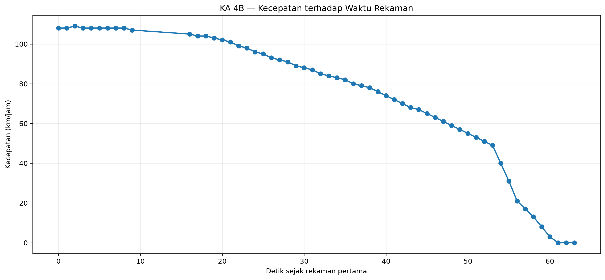

**Gambar 7.2. Tekanan Brake Pipe dan Brake Cylinder terhadap waktu**

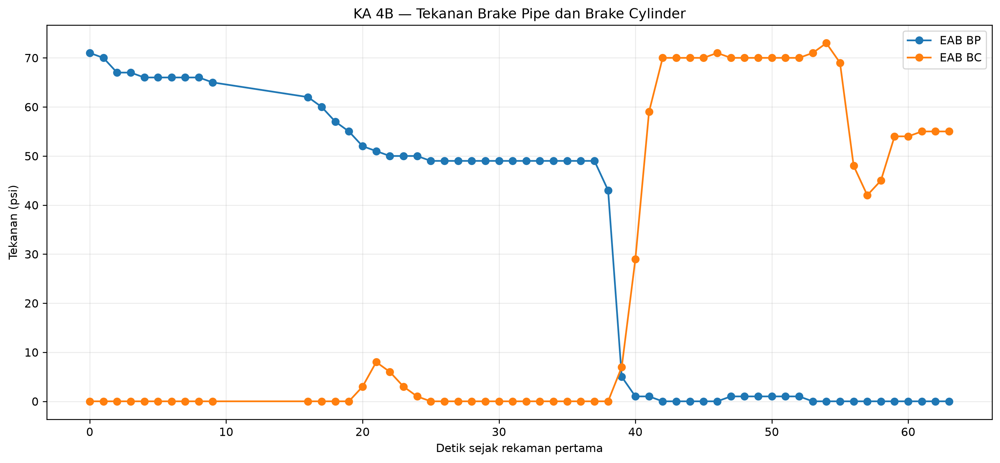

**Gambar 7.3. Heatmap korelasi Spearman**

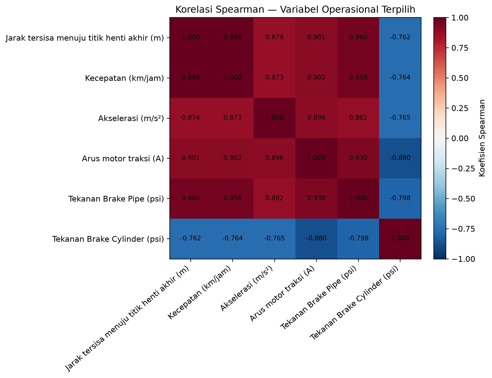

**Gambar 7.4. Animasi urutan rekaman kecepatan**

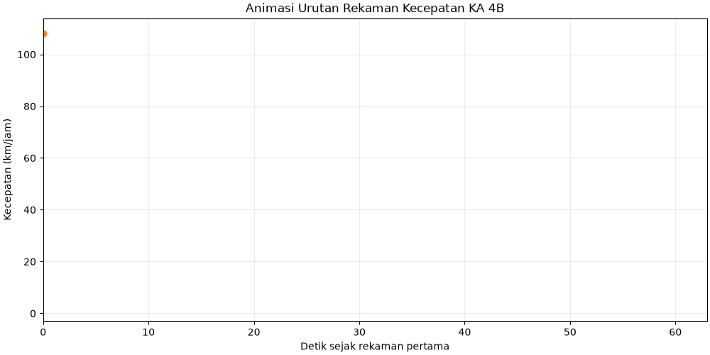

Versi interaktif tersedia pada [deret waktu kecepatan](../outputs/bab_vii/deret_waktu_interaktif.html), [deret waktu tekanan BP/BC](../outputs/bab_vii/tekanan_bp_bc_interaktif.html), dan [heatmap Spearman interaktif](../outputs/bab_vii/heatmap_spearman_interaktif.html). Jumlah pasangan valid untuk setiap koefisien korelasi disediakan pada [jumlah pasangan valid korelasi](../outputs/bab_vii/jumlah_pasangan_valid_korelasi.csv).

Sumber seluruh gambar: hasil olah penulis dari transkripsi Data Logger KA 4B. Grafik dan animasi hanya memvisualisasikan rekaman yang tersedia; animasi bukan simulasi gerak fisik atau rekonstruksi kausal.

## 7.3 Analisis Korelasi

Notebook analisis menghitung korelasi Spearman secara eksploratif pada `distance_to_stop_m`, `Speed (km/h)`, `Acceleration (m/sec²)`, `Load (amps)`, `EAB BP (psi)`, dan `EAB BC (psi)`. Kolom sumber `km` dan `m` tidak dimasukkan secara terpisah; placeholder akselerasi dikecualikan secara numerik. Pasangan variabel dapat memiliki jumlah observasi yang berbeda apabila terdapat missing value; karena itu, jumlah pasangan valid perlu diperiksa bersama matriks korelasi dan tidak boleh diasumsikan selalu 58. Korelasi Spearman mengukur asosiasi monotonik, bukan pengaruh sebab-akibat.

Matriks korelasi tidak dijadikan dasar kesimpulan utama. Dataset berisi 58 rekaman unik yang berurutan dari beberapa fase operasi dalam rentang waktu singkat. Variabel dapat berubah bersama karena dipengaruhi waktu dan fase pengereman. Korelasi Pearson atau Spearman berpotensi dipengaruhi tren waktu, autokorelasi, perubahan status sistem, dan ukuran sampel yang terbatas. Apabila heatmap korelasi ditampilkan, interpretasinya harus eksploratif, disertai jumlah observasi yang digunakan, dan tidak dianggap sebagai bukti sebab-akibat atau multikolinearitas dalam model yang belum dibangun.

---

### Visual tambahan: pembacaan temporal dan hubungan parameter

**Gambar 7.5. Multi-panel perubahan parameter terhadap waktu**

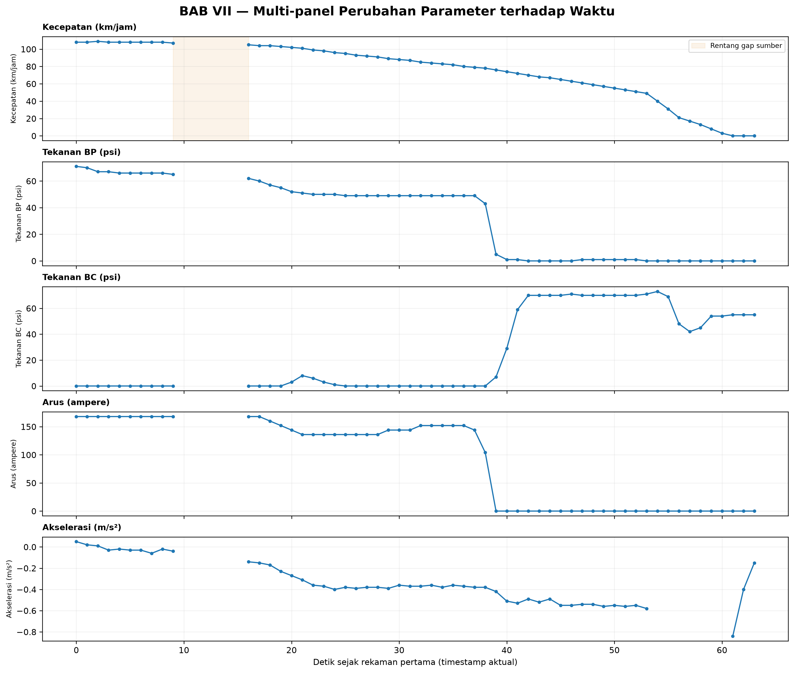

Tujuan visual adalah membandingkan kecepatan (km/jam), tekanan BP dan BC (psi), arus (ampere), serta akselerasi (m/s²) pada sumbu waktu yang sama. Cara membaca: setiap panel memiliki skala vertikal dan satuan sendiri; posisi horizontal menunjukkan detik sejak timestamp pertama. Garis diputus pada interval lebih dari satu detik, termasuk gap sumber 20:51:28–20:51:33. Visual mendukung identifikasi perubahan temporal yang berdekatan, bukan perbandingan besar nilai lintas satuan. Batasnya, EDA tidak melakukan sinkronisasi ulang secara independen. Timestamp mengikuti Tabel 6–10; KNKT menjelaskan penyesuaian +2 detik untuk logger lokomotif terhadap master time CCTV KA 5568A pada Tabel 5. Tidak dilakukan interpolasi pada gap sumber.

**Gambar 7.6. Categorical State Timeline**

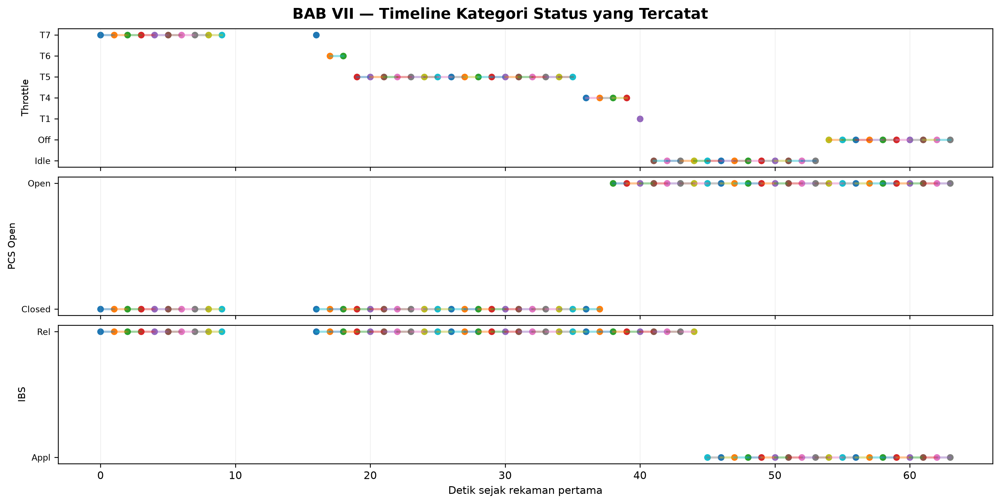

Tujuannya memperlihatkan kategori Throttle, PCS Open, dan IBS pada timestamp yang benar-benar memiliki nilai. Cara membaca: setiap titik adalah satu observasi kategori; garis hanya menghubungkan dua observasi berurutan yang sama kategorinya dan berjarak satu detik. Missing value ditampilkan sebagai gap, bukan kategori operasional. Visual mendukung urutan kategori yang tercatat, tetapi tidak mengukur durasi status secara langsung dan tidak membuktikan bahwa status bertahan di antara dua timestamp.

**Gambar 7.7. Scatter hubungan parameter operasional**

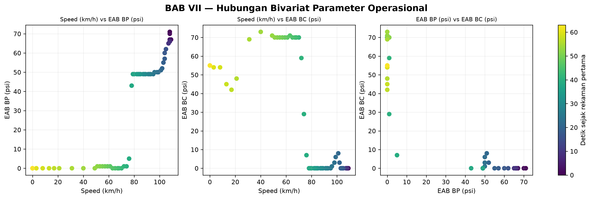

Tujuan gambar adalah mengeksplorasi pasangan Speed–BP, Speed–BC, dan BP–BC. Cara membaca: satu titik mewakili satu pasangan observasi valid, sedangkan gradasi warna menunjukkan waktu relatif. Visual mendukung inspeksi pola asosiasi dan kemungkinan pengelompokan menurut urutan waktu. Batasnya, scatter tidak mengendalikan fase operasi, autokorelasi, maupun faktor lain; pola tidak membuktikan hubungan sebab-akibat.

# BAB VIII. DETEKSI PENCILAN DAN ANALISIS ANOMALI (OUTLIER AND ANOMALY ANALYSIS)

## 8.1 Konsep dan Metode Deteksi Pencilan

Deteksi menggunakan aturan Interquartile Range (IQR), dengan batas bawah Q1 − 1,5 × IQR dan batas atas Q3 + 1,5 × IQR. Pada 58 rekaman gabungan (51 nilai akselerasi numerik), pemeriksaan dilakukan pada enam variabel analitis: `distance_to_stop_m`, `Speed (km/h)`, `Acceleration (m/sec²)`, `Load (amps)`, `EAB BP (psi)`, dan `EAB BC (psi)`. Tidak ditemukan kandidat di luar pagar IQR. Kolom sumber `km` dan `m` dikeluarkan dari uji IQR karena merupakan komponen besaran jarak yang sama, bukan variabel independen. Z-score tidak digunakan sebagai metode utama karena distribusi normal tidak dapat diasumsikan pada cuplikan runtun waktu yang kecil dan berurutan.

**Gambar 8.1. Box plot variabel numerik dan pemeriksaan IQR**

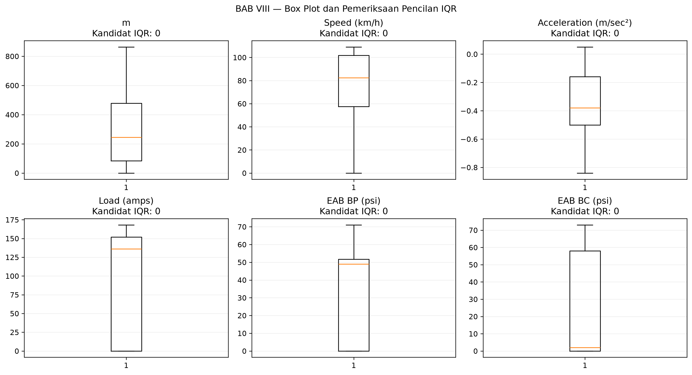

Tabel hasil perhitungan pagar dan jumlah kandidat pencilan dapat diperiksa pada [ringkasan IQR](../outputs/bab_viii/ringkasan_iqr.csv). Penandaan statistik tidak otomatis berarti kesalahan data atau anomali operasional.

Sumber: hasil olah penulis dari dataset transkripsi.

### Visual tambahan: jumlah kandidat dan konteks temporal

**Gambar 8.2. Jumlah kandidat pencilan IQR**

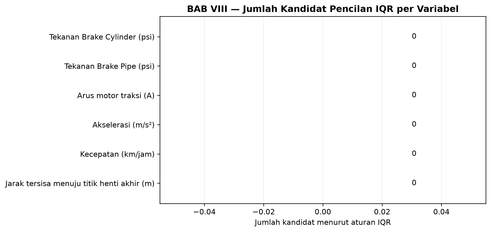

Tujuan gambar adalah membandingkan jumlah kandidat menurut pagar 1,5 × IQR untuk enam variabel numerik analitis. Cara membaca: panjang batang menunjukkan jumlah observasi di luar pagar; jumlah valid dan batas pagar tetap dirujuk pada CSV ringkasan IQR. Visual mendukung hasil nol kandidat pada enam variabel tersebut. Batasnya, aturan IQR hanya mendeteksi kandidat statistik dan bukan anomali teknis; kolom sumber `km` dan `m` tidak diuji secara terpisah.

**Gambar 8.3. Konteks temporal parameter**

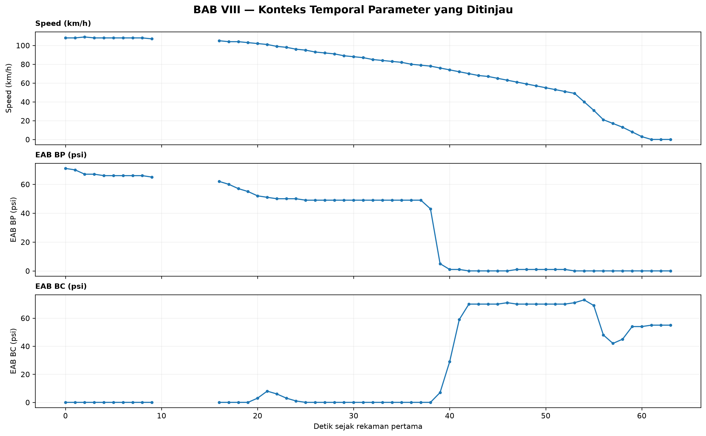

Tujuannya menempatkan kecepatan, BP, dan BC dalam urutan waktu untuk meninjau perubahan nilai pada konteksnya. Cara membaca: masing-masing panel menggunakan satuan variabelnya, dan garis terputus saat gap timestamp. Visual mendukung penelaahan apakah nilai yang tampak ekstrem bertepatan dengan perubahan temporal yang tercatat. Batasnya, gambar tidak mengklasifikasikan anomali, tidak menetapkan batas aman, dan tidak menyimpulkan penyebab perubahan.

## 8.2 Analisis Kontekstual dan Keputusan Perlakuan Pencilan

Semua nilai dipertahankan. Nilai ekstrem terjadi dalam cuplikan perubahan keadaan pengereman, sehingga secara domain dapat merepresentasikan transisi sistem yang justru penting untuk diamati. Tidak dilakukan trimming, capping, winsorization, atau transformasi untuk menyembunyikan nilai ekstrem. Setiap koreksi hanya dapat dilakukan jika ditemukan kesalahan transkripsi yang dapat dibuktikan dengan membandingkan kembali ke tabel sumber. Perlu dibedakan tiga konsep: (1) pencilan statistik, yaitu nilai yang berada di luar pagar metode statistik; (2) anomali operasional, yaitu perilaku yang menyimpang dari ekspektasi teknis berdasarkan konteks sistem; dan (3) bukti kegagalan/penyebab, yang memerlukan verifikasi teknis dan bukti independen. Ketiganya tidak saling identik. Hasil IQR pada dataset ini tidak menemukan pencilan pada enam variabel numerik operasional, tetapi hal tersebut tidak membuktikan bahwa seluruh perilaku sistem normal atau bebas anomali.

---

# BAB IX. KESIMPULAN, TEMUAN, DAN REKOMENDASI (COMMUNICATE FINDINGS AND INSIGHTS)

## 9.1 Rangkuman Temuan Utama

Ringkasan berikut menggabungkan dua tingkat bukti: (1) nilai pada transkripsi Tabel 6–10 dan (2) penamaan fase serta penjelasan KNKT pada Bab II.3 dan grafik Lampiran 7. Dataset EDA memuat 58 rekaman unik dari 59 baris sumber; satu rekaman 20:51:43 tercantum identik pada Tabel 7 dan 8. Tidak dilakukan interpolasi untuk celah 20:51:28–20:51:33.

### Audit kronologi parameter pada timestamp kunci

| Timestamp Tabel 6–10 | Fase/konteks KNKT | Speed (km/jam) | BP (psi) | BC (psi) | Load (A) | Throttle | PCS Open | IBS | Catatan audit |
|---|---|---:|---:|---:|---:|---|---|---|---|
| 20:51:18 | Awal minimum reduction pada tabel | 108 | 71 | 0 | 168 | T7 | Closed | Rel | Awal rekaman gabungan |
| 20:51:27 | Akhir interval minimum reduction | 107 | 65 | 0 | 168 | T7 | Closed | Rel | BP turun 6 psi dari 71 menjadi 65 |
| 20:51:34 | Peralihan menuju full service | 105 | 62 | 0 | 168 | T7 | Closed | Rel | Timestamp pertama setelah gap; tidak mengisi 20:51:28–33 |
| 20:51:39 | Full service sedang terbentuk | 101 | 51 | 8 | 136 | T5 | Closed | Rel | BC mencapai 8 psi |
| 20:51:43 | Awal rentang full service pada Tabel 8/grafik | 95 | 49 | 0 | 136 | T5 | Closed | Rel | BP 49 psi pada awal tabel full service |
| 20:51:55 | Akhir rentang full service pada tabel | 79 | 49 | 0 | 144 | T4 | Closed | Rel | Baris terakhir Tabel 8 |
| 20:51:56 | Awal emergency brake (Tabel 9) | 78 | 43 | 0 | 104 | T4 | Open | Rel | BP mulai turun tajam; PCS Open |
| 20:52:00 | Emergency brake aktif | 70 | 0 | 70 | 0 | Idle | Open | Rel | BP 0 psi, BC 70 psi, arus 0 A |
| 20:52:03 | IBS pertama kali tercatat Appl | 65 | 0 | 70 | 0 | Idle | Open | Appl | KNKT menyebut aktivasi independent brake pada waktu ini |
| 20:52:09 | Menjelang tabrakan | 53 | 1 | 70 | 0 | Idle | Open | Appl | Akselerasi masih numerik (-0,56 m/s²) |
| 20:52:11 | Satu detik sebelum tabrakan | 49 | 0 | 71 | 0 | Idle | Open | Appl | Akselerasi -0,58 m/s² |
| 20:52:12 | Tabrakan | 40 | 0 | 73 | 0 | Off | Open | Appl | Akselerasi placeholder ---; KNKT menyebut titik tabrakan km 28+915 |
| 20:52:14–20:52:16 | Setelah tabrakan, lokomotif masih bergerak | 21, 17, 13 | 0 | 48, 42, 45 | 0 | Off | Open | Appl | BC turun dari 73 psi; nilai 48, 42, dan 45 psi berurutan |
| 20:52:18 | Menjelang berhenti | 3 | 0 | 54 | 0 | Off | Open | Appl | `km=0` dan `m=0`; jarak tersisa tercatat 0 m meskipun speed masih 3 km/jam |
| 20:52:19 | Lokomotif berhenti | 0 | 0 | 55 | 0 | Off | Open | Appl | KNKT menyebut titik berhenti km 28+941, 26 m setelah titik tabrakan |
| 20:52:20–20:52:21 | Setelah berhenti | 0 | 0 | 55 | 0 | Off | Open | Appl | Kecepatan tetap 0 km/jam |

> **Cakupan tabel:** tabel ini menyajikan timestamp kunci untuk menjelaskan perubahan fase dan parameter, bukan daftar lengkap seluruh 58 rekaman. Dataset lengkap tetap berada pada `data/processed/data_logger_knkt_tabel_6_10.csv`; timestamp yang tidak ditampilkan di tabel ringkasan tidak berarti rekamannya dihapus.

**Catatan waktu.** Tabel 5 KNKT menjelaskan bahwa timestamp Data Logger lokomotif saat tabrakan yang semula 20:52:10 disesuaikan menjadi 20:52:12 berdasarkan CCTV KA 5568A sebagai master time, yaitu koreksi +2 detik. Timestamp Tabel 6–10 yang digunakan dalam EDA diperlakukan sebagai waktu sebagaimana disajikan dalam tabel laporan KNKT; koreksi +2 detik tidak diterapkan kembali. Uraian naratif KNKT menyebut fase service brake mulai 20:51:16 dan berakhir 20:51:53, sedangkan tabel/grafik menyajikan rentang waktu yang bergeser +2 detik, sekitar 20:51:18–20:51:55. Perbedaan ini dicatat agar waktu logger awal tidak tercampur dengan waktu rujukan investigasi.

**Batas fase.** Tabel 6 merekam minimum reduction pada 20:51:18–20:51:27. Tabel 7 dan narasi KNKT mendokumentasikan peralihan menuju full service setelah 20:51:34; Tabel 8 memperlihatkan full service pada 20:51:43–20:51:55. Tabel 9 dimulai pada 20:51:56 untuk emergency brake. Grafik KNKT menandai tahap emergency brake + independent brake sekitar 20:52:02, sedangkan status IBS pada tabel pertama kali berubah dari Rel menjadi Appl pada 20:52:03. Perbedaan antara penanda fase grafik dan observasi diskret IBS dipertahankan, bukan diseragamkan.

### Ringkasan temuan yang didukung data

1. **Kecepatan.** Nilai tertinggi adalah 109 km/jam pada 20:51:20. Pada timestamp tabrakan 20:52:12, kecepatan tercatat 40 km/jam; pada 20:52:19–20:52:21 tercatat 0 km/jam. Tabrakan dan berhenti merupakan dua peristiwa berbeda yang terpisah tujuh detik dalam tabel.
2. **Brake Pipe (BP).** BP turun dari 71 psi pada 20:51:18 menjadi 65 psi pada 20:51:27. Nilainya 49 psi pada 20:51:43–20:51:55, lalu turun dari 43 psi pada 20:51:56 menjadi 0 psi pada 20:52:00. BP tercatat 0 psi pada timestamp tabrakan dan hingga rekaman terakhir.
3. **Brake Cylinder (BC).** BC tercatat 0 psi pada 20:51:18–20:51:37, naik menjadi 8 psi pada 20:51:39, lalu kembali 0 psi pada 20:51:43–20:51:56. Pada fase emergency, BC naik menjadi 70 psi pada 20:52:00. Nilai maksimum dataset adalah 73 psi pada 20:52:12. Setelah tabrakan BC tercatat 48 psi pada 20:52:14, 42 psi pada 20:52:15, dan 45 psi pada 20:52:16; nilainya menjadi 55 psi ketika lokomotif berhenti pada 20:52:19.
4. **Arus motor traksi (Load).** Arus tercatat 168 A pada 20:51:18–20:51:36. Pada 20:51:56 tercatat 104 A dan pada 20:51:57 tercatat 0 A; nilainya tetap 0 A hingga rekaman terakhir. Satuan kolom adalah ampere (A), bukan kW.
5. **Throttle, PCS, dan IBS.** Throttle berada pada T7 di awal rekaman, turun bertahap ke T5 dan T4, kemudian T1 dan Idle, serta tercatat Off pada 20:52:12. PCS Open tercatat Closed sampai 20:51:55 dan Open mulai 20:51:56. IBS tercatat Rel sampai 20:52:02 dan Appl mulai 20:52:03. Frekuensi kategori merangkum jumlah observasi, bukan durasi status.
6. **Akselerasi.** Tujuh placeholder --- berturut-turut muncul pada 20:52:12–20:52:18. Nilai tidak dihitung sebagai angka. Nilai numerik kembali tersedia pada 20:52:19 (-0,84 m/s²), 20:52:20 (-0,40 m/s²), dan 20:52:21 (-0,15 m/s²). Penjelasan KNKT mengenai respons sensor terhadap G-Force dicatat sebagai konteks sumber, bukan hasil pengukuran ulang EDA.
7. **Jarak tersisa menuju titik henti akhir.** Besaran `distance_to_stop_m` menurun dari 1.341 m pada 20:51:18 menjadi 26 m pada timestamp tabrakan 20:52:12, lalu 0 m pada rekaman berhenti 20:52:19. Pada tabel sumber, nilai 26 m tersusun dari `km=0` dan `m=26`; nilai nol saat berhenti tersusun dari `km=0` dan `m=0`. Besaran ini mengikuti definisi jarak tersisa terhadap titik henti akhir, bukan chainage absolut atau jarak pengereman murni. Perlu dicatat bahwa pada 20:52:18 jarak tersisa sudah tercatat 0 m, sedangkan kecepatan masih 3 km/jam; kecepatan baru tercatat 0 km/jam pada 20:52:19. Perbedaan dua pembacaan diskret ini dipertahankan sebagaimana tercantum pada tabel sumber dan tidak ditafsirkan sebagai bukti bahwa lokomotif telah berhenti pada 20:52:18.

### Frekuensi kategori

Frekuensi kategori untuk 58 rekaman gabungan:

| Variabel | Kategori | Frekuensi | Nilai tersedia |
|---|---|---:|---:|
| Throttle | T5 | 17 | 58 |
| Throttle | Idle | 13 | 58 |
| Throttle | T7 | 11 | 58 |
| Throttle | Off | 10 | 58 |
| Throttle | T4 | 4 | 58 |
| Throttle | T6 | 2 | 58 |
| Throttle | T1 | 1 | 58 |
| PCS Open | Closed | 32 | 58 |
| PCS Open | Open | 26 | 58 |
| IBS | Rel | 39 | 58 |
| IBS | Appl | 19 | 58 |
| DB Excit | Off | 32 | 32 |
| Dir Call | For | 32 | 32 |
| DB Set | No | 32 | 32 |
| DB Star | No | 32 | 32 |

Empat kolom status terakhir hanya tersedia pada 32 baris Tabel 6–8; 26 sel kosong pada Tabel 9–10 merupakan ketidaktersediaan struktural. Denominator 32 untuk empat kolom tersebut tidak boleh disamakan dengan 58 rekaman keseluruhan.

### Statistik deskriptif yang diaudit

Statistik diverifikasi kembali terhadap CSV analitis. Statistik jarak dihitung dari `distance_to_stop_m`, bukan dari kolom `m` saja atau `km` dan `m` secara terpisah. Untuk akselerasi, n=51 karena tujuh placeholder dikecualikan dari perhitungan numerik.

| Variabel | n valid | Mean | Median | Std. deviasi | Minimum | Maksimum |
|---|---:|---:|---:|---:|---:|---:|
| distance_to_stop_m | 58 | 472,897 | 378,5 | 421,531 | 0 | 1.341 |
| Speed (km/h) | 58 | 73,638 | 82,5 | 33,077 | 0 | 109 |
| Acceleration (m/sec²) | 51 | -0,336 | -0,38 | 0,203 | -0,84 | 0,05 |
| Load (amps) | 58 | 86,207 | 136 | 76,587 | 0 | 168 |
| EAB BP (psi) | 58 | 31,897 | 49 | 28,264 | 0 | 71 |
| EAB BC (psi) | 58 | 26,000 | 2 | 31,191 | 0 | 73 |

Mean dan simpangan baku adalah ringkasan seluruh rentang, bukan nilai parameter pada fase tertentu. Karena data runtun waktu berasal dari satu kejadian dan memiliki ketergantungan temporal, statistik gabungan tidak digunakan untuk mengestimasi perilaku umum armada atau sistem.

### Hasil audit pencilan IQR

Pagar dihitung dengan Q1 − 1,5 × IQR dan Q3 + 1,5 × IQR menggunakan kuartil Pandas pada salinan analisis. Hasil dari outputs/bab_viii/ringkasan_iqr.csv:

| Variabel | n valid | Pagar bawah | Pagar atas | Kandidat IQR |
|---|---:|---:|---:|---:|
| distance_to_stop_m | 58 | -861,500 | 1.702,500 | 0 |
| Speed (km/h) | 58 | -8,875 | 168,125 | 0 |
| Acceleration (m/sec²) | 51 | -1,010 | 0,350 | 0 |
| Load (amps) | 58 | -228,000 | 380,000 | 0 |
| EAB BP (psi) | 58 | -77,625 | 129,375 | 0 |
| EAB BC (psi) | 58 | -87,000 | 145,000 | 0 |

Kolom sumber `km` dan `m` tidak dimasukkan sebagai variabel terpisah karena keduanya membentuk `distance_to_stop_m`. Tidak adanya kandidat IQR bukan bukti bahwa seluruh sistem beroperasi normal atau bebas anomali teknis.

**Gambar 9.1. Ikhtisar temuan EDA**

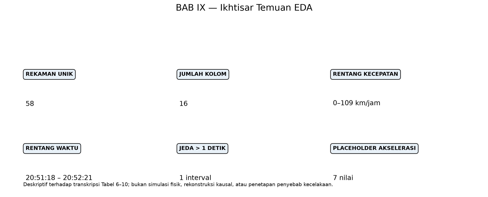

Gambar merangkum ukuran dataset dan nilai cakupan. Nilai per timestamp, satuan, frekuensi kategori, dan hasil IQR dirinci pada tabel audit dan keluaran CSV; gambar ringkasan tidak menggantikan tabel angka.

Sumber: hasil olah penulis dari transkripsi Tabel 6–10. Batas fase dan keterangan investigasi merujuk pada KNKT Bab II.3, Tabel 5–10, serta grafik Lampiran 7.

## 9.2 Keterbatasan Analisis

- Dataset mencakup Tabel 6–10 sebagaimana disajikan pada halaman tercetak 65–68 laporan KNKT. Dataset tetap bukan ekspor mentah perangkat logger dan tidak mencakup data lain di luar tabel tersebut.
- Jumlah data gabungan adalah 58 timestamp unik dari 59 baris sumber; terdapat celah enam detik antara Tabel 6 dan Tabel 7.
- Empat kolom kosong karena tidak tersedia pada dua tabel sumber.
- Tujuh nilai akselerasi berupa placeholder `---`; nilai tersebut tidak dapat digunakan dalam perhitungan numerik.
- Data bersifat time-series dan berurutan, sehingga asumsi independensi sampel tidak dapat langsung digunakan.
- Analisis bergantung pada transkripsi tabel PDF. Pemeriksaan visual telah dilakukan, tetapi verifikasi independen oleh pemeriksa kedua terhadap setiap sel masih direkomendasikan.
- Data logger lokomotif saja tidak mewakili seluruh faktor teknis, operasional, persinyalan, kondisi lintas, dan rangkaian kereta.
- EDA tidak membuktikan sebab-akibat, kelalaian, atau tanggung jawab pihak tertentu.

## 9.3 Rekomendasi Pengembangan Analisis

1. Lakukan verifikasi independen kedua terhadap transkripsi Tabel 6–8, terutama angka yang dibaca dari tabel raster, sebelum menjadikannya data final publikasi.
2. Lakukan verifikasi ganda (double-entry/checking) terhadap setiap sel hasil transkripsi dengan gambar tabel PDF.
3. Simpan dataset mentah tanpa perubahan, kemudian buat salinan analisis dengan tipe datetime dan numerik yang eksplisit.
4. Tambahkan pemeriksaan otomatis untuk jumlah kolom, jumlah baris, urutan waktu, duplikasi, placeholder, dan nilai di luar rentang yang dapat diverifikasi.
5. Perluas konteks dengan bagian laporan KNKT yang menjelaskan kronologi, persinyalan, komunikasi, serta sistem pengereman.
6. Jangan menerapkan SMOTE, klasifikasi, regresi, atau algoritma prediktif sebelum tujuan prediksi, target, cakupan data, dan strategi validasi runtun waktu dirumuskan.
7. Jika analisis lanjutan bertujuan mendeteksi anomali, definisikan terlebih dahulu anomali berdasarkan konteks teknis dan validasi domain; jangan menjadikan pencilan IQR sebagai label kesalahan secara otomatis.
8. Jika dokumen sumber tersedia, ekstrak log persinyalan/interlocking, catatan perjalanan aktual dan izin masuk petak, serta kronologi komunikasi PPKA/OC/masinis dengan mempertahankan file asli, metadata, zona waktu, dan hash integritasnya.
9. Peroleh data logger KA 5568A dan dokumentasi sumber waktunya sebelum melakukan sinkronisasi dua kereta. Lakukan koreksi offset/drift hanya jika ada dasar teknis yang dapat diuji; laporkan rentang ketidakpastian waktu.
10. Untuk kajian pengereman, kumpulkan parameter massa dan komposisi rangkaian, karakteristik rem, gradien lintas, kondisi adhesi roda-rel, kecepatan, tekanan dan waktu respons. Jangan menyimpulkan jarak henti dari perubahan kecepatan saja tanpa model dan parameter yang tervalidasi.
11. Untuk aspek persinyalan, ATP/SPAD, geometri lintas, visibilitas, faktor manusia, dan crashworthiness, gunakan bukti primer yang sesuai: log perangkat yang benar-benar terpasang, diagram interlocking, track chart, survei lapangan, rekaman komunikasi, pemeriksaan sarana, dan dokumen prosedur. Jika bukti tidak tersedia, nyatakan sebagai keterbatasan, bukan mengisi dengan asumsi.
12. Simpan setiap sumber sebagai artefak immutable, catat asal-usul dan checksum, pisahkan data mentah, data hasil transkripsi, data hasil normalisasi waktu, dan data analisis; lakukan validasi skema, unit test, pemeriksaan perubahan, serta review independen sebelum rilis dataset.
13. Untuk pemodelan lanjutan, prioritaskan metode yang sesuai dengan tujuan dan struktur data. Dengan 58 rekaman dari satu kejadian, dataset ini belum memadai untuk melatih model prediktif yang dapat digeneralisasi. Model anomali atau klasifikasi baru dipertimbangkan setelah tersedia kumpulan kejadian yang representatif, label yang tervalidasi, dan strategi validasi berbasis waktu/kejadian agar tidak terjadi data leakage.

---

## REFERENSI

Komite Nasional Keselamatan Transportasi. (2026). *Laporan akhir investigasi kecelakaan perkeretaapian: Tabrakan antara KA 4B Argo Bromo Anggrek dan KA 5568A Commuter Line, Jalur 1 Stasiun Bekasi Timur, Daop 1 Jakarta, 27 April 2026* (Nomor laporan KNKT.26.04.03.02). https://knkt.go.id/Repo/Files/Laporan/Perkeretaapian/2026/KNKT.26.04.03.02-Final-Report.pdf

## CATATAN REPRODUKSIBILITAS

- Input reproduksibel di repository: `data/processed/data_logger_knkt_tabel_6_10.csv`. Workbook kerja eksternal `data_logger_knkt_tabel_6_10_lengkap.xlsx` (sheet `Data_Logger_Raw`) merupakan catatan proses transkripsi/audit dan tidak disertakan; workbook tersebut bukan prasyarat untuk menjalankan ulang pipeline.
- Cakupan sumber: Tabel 6–10, halaman tercetak 65–68.
- Baris transkripsi dari seluruh tabel: 59; dataset gabungan setelah menghapus satu duplikasi identik lintas Tabel 7–8: 58 baris × 16 kolom.
- Gap sumber: tidak ada rekaman yang ditampilkan untuk 20:51:28–20:51:33; tidak dilakukan interpolasi.
- File CSV proyek: `data/processed/data_logger_knkt_tabel_6_10.csv`.
- Placeholder `---` dipertahankan pada data mentah dan hanya dikecualikan dari kalkulasi numerik akselerasi.
- Tidak dilakukan imputasi, penghapusan baris, penghapusan kolom, scaling, encoding, atau transformasi terhadap dataset mentah.
- CSV transkripsi Tabel 6–10 disertakan pada repositori di `data/processed/`; PDF sumber tidak disertakan. Penggunaan ulang dataset harus tetap mencantumkan laporan KNKT sebagai sumber dan memperhatikan ketentuan penggunaan materi sumber.


## KATALOG VISUALISASI DAN PANDUAN INTERPRETASI

Untuk menjaga uraian setiap gambar tetap konsisten dan mudah ditelusuri, laporan ini dilengkapi katalog visual per bab yang menjelaskan tujuan, cara membaca, batas interpretasi, dan alasan visual yang tidak relevan tidak dibuat. Lihat [Katalog Visualisasi dan Panduan Interpretasi](../docs/KATALOG_VISUALISASI.md). Katalog mencakup seluruh visual yang dipertahankan dan visual tambahan yang dihasilkan oleh generator.
